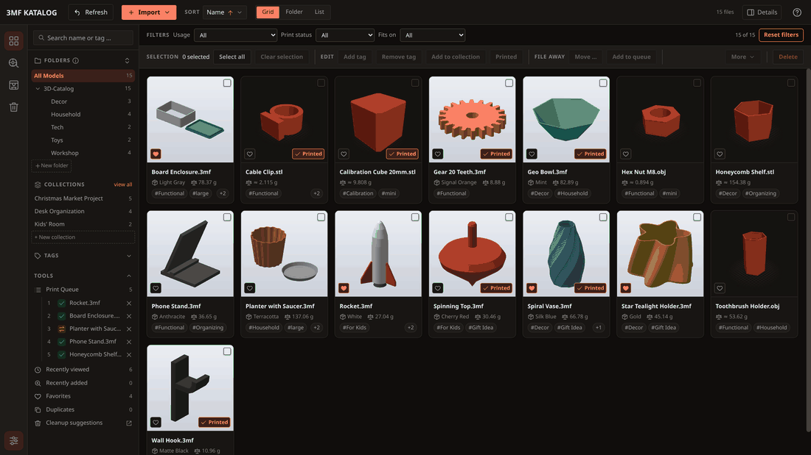

# 3MF Katalog Manager

🇩🇪 **Deutsch:** [README auf Deutsch](README.de.md)

[](https://github.com/Bexxs75/3mf-katalog-manager/releases/latest) [](https://github.com/Bexxs75/3mf-katalog-manager/actions/workflows/ci-checks.yml) [](https://github.com/Bexxs75/3mf-katalog-manager/releases) [](#download) [](LICENSE) [](https://discord.gg/abfVNfFqu3)

**Your 3MF, STL and STEP collection keeps growing? The 3MF Katalog Manager catalogs the folders you already have, finds any model in seconds, shows it in 3D and connects your files with filament, print queue and print history. Everything stays on your computer: no account, no cloud.**



- **100 % local** — no sign-up, no cloud, no tracking. Your files stay where they are.
- **Your existing folders, searchable** — import folders, get automatic tags, real 3D previews and slicer data (weight, filament per plate).
- **More than a file browser** — filament and resin storage with AMS slots, print queue, print log and an optional connection to Klipper printers.

Free and open source (MIT) · Windows, macOS, Linux · English, German, Spanish, French · [Website](https://3mfkatalog.de/en/) · [User guide](docs/benutzerhandbuch/BENUTZERHANDBUCH.md)

## Download

[](https://3mfkatalog.de/en/#download) [](https://3mfkatalog.de/en/#download) [](https://3mfkatalog.de/en/#download)

The buttons open the download section of the website, which always offers the newest version. All files and checksums: [latest release](https://github.com/Bexxs75/3mf-katalog-manager/releases/latest).

From v0.16.0, there is one download per system: Windows `.msi`, macOS `.dmg` (Intel and Apple Silicon), Linux `.AppImage`. STEP preview is always included, making the download larger than the former standard package. File names have no `-STEP` suffix. Existing standard installations receive it through the next in-app update.

## Compatibility

| Area | Status |
|---|---|
| Windows (`.msi`) | available, unsigned |
| macOS, Intel and Apple Silicon (`.dmg`) | available, unsigned |
| Linux (`.AppImage`) | available; `.deb`, `.rpm` and AUR planned |
| 3MF, STL, OBJ | catalog and 3D preview |
| STEP (`.stp`/`.step`) | catalog and 3D preview (included from v0.16.0) |
| OrcaSlicer / Bambu Studio 3MF | filament usage and weight per plate supported |
| Open in slicer | Bambu Studio, OrcaSlicer, PrusaSlicer, SuperSlicer, UltiMaker Cura detected automatically, others can be added |
| Klipper / Moonraker | available; [more printer models wanted](https://3mfkatalog.de/en/printer-test.html) |
| OctoPrint | planned |
| Bambu Lab (LAN) | planned, depends on a test on real printers |
| PrusaLink | planned later |
| Languages | English, German, Spanish, French |

### Tested printers

| Printer | System | Checked | Result |
|---|---|---|---|
| Sovol SV08 | Stock Klipper | Print list and usage, deducting from the spool in the app | ✅ Confirmed in daily use |
| Anycubic Kobra S1 with ACE Pro / ACE Pro 2 | Rinkhals | Print list and usage, deducting from the spool, matching file names to the model; cancelled prints are deducted with the actual amount; two printers side by side | ✅ Confirmed in long-term use (2 printers) |
| Qidi Smart 3 | Stock Klipper | Print list and usage readable; the printer's clock was wrong | 🟡 From v0.15.0 |
| Creality K2 Plus (with CFS) | Creality Klipper 1.1.6.1, rooted | Print list and usage readable; no material or weight from the slicer, so the spool is chosen by hand | ☑️ Test report checked |
| Qidi Q1 Pro | Stock Klipper (Moonraker 0.7.1) | Print list and usage readable; material and weight come from the slicer (QIDISlicer) | ☑️ Test report checked |

*Confirmed in daily use*: tried with the app on a real printer. *Confirmed in long-term use*: used by users in everyday printing over a longer period and reported back. *Test report checked*: the data from the anonymous [test form](https://3mfkatalog.de/en/printer-test.html) fits, a hands-on test is still missing. Your printer is missing? Your test adds it.

## Is it safe to install?

Windows and macOS show a warning on the first start because the packages are **not code-signed**: the certificates for that cost money every year, which a free hobby project can't cover yet. The warning says "unknown publisher", not that anything harmful was found.

What you can check yourself:

- **Open source:** every release is built from the public source code by [GitHub Actions workflows](https://github.com/Bexxs75/3mf-katalog-manager/tree/master/.github/workflows). The source of each version is the matching tag, e.g. [v0.15.0](https://github.com/Bexxs75/3mf-katalog-manager/tree/v0.15.0).
- **Checksums:** every release contains `SHA256SUMS.txt`. Compare it with the hash of your download:
  - Windows (PowerShell): `Get-FileHash .\3MF-Katalog-Manager-0.16.0-Windows-x64.msi -Algorithm SHA256`
  - macOS: `shasum -a 256 3MF-Katalog-Manager-0.16.0-macOS-universal.dmg`
  - Linux: `sha256sum -c SHA256SUMS.txt --ignore-missing`
- **Starting anyway:** Windows SmartScreen: "More info" → "Run anyway". macOS: right-click the app → "Open"; on macOS 15 or newer: System Settings → Privacy & Security → "Open Anyway".
- **Local only:** the app works offline. It only goes online to check GitHub for a newer version, to download it when you choose to update, and, if you switch it on, to talk to printers on your home network.
- **Antivirus programs** such as Avast or AVG sometimes block new, unsigned programs as a precaution. Restore the file from quarantine and add the installation folder as an exception; you can check the file on [VirusTotal](https://www.virustotal.com) first.
- **Uninstalling** removes the program but keeps your catalog, settings and logs on purpose. The [user guide](docs/benutzerhandbuch/BENUTZERHANDBUCH.md#uninstalling) lists the folders to delete if you want everything gone.

## Updates

From v0.15.0 the app checks for updates on startup and can install them itself on Windows, macOS, and the Linux AppImage. "Update now" downloads the signed package. "Restart and install" first backs up your catalog database (the last 3 backups are kept, in `update-backups` inside the app's data folder), then installs the update. Linux `.deb`/`.rpm` installs show a "Go to download page" button instead, since only the AppImage can replace itself.

Installations of 0.14 or older have to be updated once by hand — download 0.15.0 from the [website](https://3mfkatalog.de/en/#download) or the [latest release](https://github.com/Bexxs75/3mf-katalog-manager/releases/latest); every version from 0.15.0 onward then updates itself. Details, including how to restore a backup: [user guide](docs/benutzerhandbuch/BENUTZERHANDBUCH.md#updating).

## What it does

- **Find and organize models** — import files or whole folders, automatic tags, search, folders, collections, favorites, duplicates detection, trash.
- **Remove from catalog / Reset catalog** — remove models or folders, or empty the catalog, without changing files on disk.
- **Understand files and metadata** — 3D preview for 3MF, STL, OBJ (and STEP), dimensions, volume, build plates, filament usage and weight from OrcaSlicer/Bambu Studio.
- **Manage filament and resin** — spools and resin bottles with stock, location and price, printers with AMS/MMU slots, "Is there enough filament?" per model.
- **Plan and document prints** — print queue, print status, print log with photos, estimated material cost, open in your slicer with one click.
- **Connect printers** — optional, read-only: Klipper/Moonraker printers report the filament used, you confirm and it is deducted. OctoPrint and Bambu Lab are planned.
- **Safe and local** — catalog backup as ZIP, archives extracted safely, Content Security Policy, no cloud.

<details>
<summary><b>All features in detail</b></summary>

- **3MF, STL, OBJ, and STEP parsing** — 3MF (OPC container extraction incl. embedded thumbnail), ASCII/binary STL, and OBJ each have a 3D preview; STEP files (`.stp`/`.step`) are read through Open CASCADE and provide a 3D preview, dimensions, volume, and body count. From v0.16.0, every platform (Linux/Windows/macOS) ships one download with STEP preview included — see [Downloads](#downloads).
- **Automatic metadata extraction** — dimensions, volume, object count, material (if present in the 3MF)
- **Automatic hashtag generation** — suggestions from filename, geometry features, and slicer profile data, editable by the user
- **Live 3D preview** — three.js rendering directly from the mesh geometry when no embedded thumbnail is available
- **Tag and folder management**, search and filtering
- **Import** of individual files or entire folders (including subfolders) via dialog or drag & drop, through a shared dropdown menu in the header
- **Comfort view** — alternative, significantly more readable interface (larger text, graphics, and controls) alongside the existing compact view, toggleable in the settings panel; favorite marking per model in both views
- **Open in slicer** — launch any number of self-configured slicer programs (vendor-agnostic) directly from the catalog
- **Multilingual UI** — German, English, Spanish, French, switchable at runtime
- **Light/dark theme** with system detection and manual selection, persisted locally
- **Material Manager** — standalone management of your filament spools (material, manufacturer, color, storage location, diameter, original/remaining weight, price) with autocomplete for material/manufacturer/location, independent of the model catalog; toggleable between a card dashboard (stock bar, status color) and a sortable inventory list, including a stats bar and status filters; when adding new spools, several identical ones can be created at once (each with its own independently tracked remaining stock); "＋ Restock" on the card or "＋" in the list row adds 1 to 20 new, full spools with the same details; double-clicking a card or row opens the edit form; remaining weights to 0.1 g; spool image by click or drag & drop (PNG, JPG or WebP up to 5 MB); spools without an image show a spool icon in their color in the list
- **Resin in the stock** — the "Filament | Resin" switch at the top of the Material Manager changes to your resin bottles: amounts in ml, separate stats ("Total bottles"), suggestions for resin material and manufacturer, "− Use" to deduct the milliliters you used, and restocking just like spools; new entries get the type of the selected area. Resin never goes into a filament slot, only into the resin vat of a resin printer, and is left out of "Is there enough filament?" and the material cost estimate.
- **Printers & AMS slots** — add printers and their multi-material units in Printer Manager (Bambu AMS, AMS lite, AMS HT, Creality CFS, Prusa MMU3, Anycubic ACE Pro, spool holder, or custom with any slot count) and put spools into slots by drag & drop or click. Every new printer automatically gets a spool holder, so printers without an AMS can take a spool right away. Loaded spools are shown separately from storage in their own column; when unloaded they automatically return to their home location. Spools have a real color value (palette or hex) in addition to the color name.
- **Resin printers** — when adding a printer you choose "Filament" or "Resin". A resin printer gets a fixed resin vat for one bottle instead of the spool holder; you insert the bottle by dragging or via the vat's menu, see its color and remaining ml, and deduct usage with "− Use".
- **Is there enough filament?** — for sliced 3MF files, the detail page compares the filament requirement with your spools (material and similar color) and shows whether it is enough, enough only with a spool change, or how much is missing – including the matching spool and whether it is loaded in a printer. The print queue shows the status per entry and takes the combined requirement into account.
- **Tools** — a sidebar section with the print queue, "Recently viewed", "Recently added", "Favorites" (all models marked with a heart), "Duplicates" and cleanup suggestions, each with a count; the views filter the catalog and combine with folders, tags and search.
- **Printer connection** — optional (off by default): Klipper/Moonraker printers on your home network report the filament used by finished and aborted prints; after you confirm, it is deducted from the spool, optionally with a print log entry. Read-only, only addresses you entered yourself on your home network. See [Tested printers](#tested-printers); results for more printers are collected on the [test page](https://3mfkatalog.de/en/printer-test.html).
- **Catalog extensions** — print-status toggle + weight per model (real value from the slicer if the 3mf has already been sliced, otherwise a rough estimate from volume × material density), sorting by "last viewed", NEW badge for recently imported models, automatic detection of exact file duplicates on import via content hash
- **Filament usage from the slicer** — reads the filament usage sliced in OrcaSlicer/Bambu Studio (`Metadata/slice_info.config`): real weight instead of an estimate, breakdown per build plate and filament (type, color, grams, meters) on the model detail page; "Rescan metadata" button retrieves the values afterward if an already-catalogued file was re-sliced in OrcaSlicer/Bambu Studio
- **Material cost estimate** — for models with real slicer filament usage, an additional estimated material cost on the detail page, computed from consumption and the prices of matching spools in the Material Manager
- **Print log** — in addition to the print-status toggle, a log of multiple print attempts per model (date, note, photo), independent of print status
- **Catalog backup** — export and re-import the entire catalog (database + settings) as a ZIP, with automatic backup of the existing database before every import
- **Extract archives directly** — archives you import or drag in individually (`.zip`, `.7z`, `.rar`, `.tar`, `.tar.gz`/`.tgz`, `.tar.bz2`, `.tar.xz`, `.tar.zst`) are extracted into a subfolder after a confirmation dialog, and the models inside are cataloged. You choose the target folder, what happens when the folder already exists, and whether the original archive is deleted; nothing is ever overwritten. For security reasons, programs, scripts, and shortcuts inside archives are never extracted. Password-protected and multi-part archives are detected but not extracted.
- **Model thumbnails** — grid view shows a real image per model (own upload, embedded 3MF thumbnail, or a snapshot automatically generated from the live 3D preview), plus an optional source link per model
- **Queue** — ordered, drag-and-drop sortable list ("print next") in its own sidebar section, automatically removed when marked as printed
- **Cleanup suggestions** — manually triggered catalog scan finds orphaned file paths and stock duplicates, cleanup via a selection dialog
- **Model detail page** — full-screen view (double-click a model) with a large 3D preview, all metadata, and build-plate count for Bambu Studio/OrcaSlicer files; dedicated rotation controls (auto-rotation + 15° step buttons) in addition to free mouse dragging
- **Trash** — deleted models remain recoverable for 7 days instead of being removed immediately, own view with a count badge
- **Multi-select** — checkboxes in the catalog overview, "select all", action bar for queue/collection/print-status/tags/delete across multiple models at once
- **Keyboard shortcuts** — `/` focuses search, arrow keys navigate the grid spatially (Up/Down jumps to the next row), Space toggles the multi-select checkbox, Delete/Backspace opens the delete confirmation when a multi-selection is active
- **Rename** — rename models directly from the context menu; the file extension stays fixed
- **Automatic slicer detection** — scans known installation locations at startup (Bambu Studio, OrcaSlicer, PrusaSlicer, SuperSlicer, UltiMaker Cura on Linux/Windows) and adds matches automatically; manual addition for custom forks remains possible
- **Preferred view** — setting for whether the catalog and detail page default to the embedded file image or a rendered 3D view; missing snapshots are automatically re-rendered in the background as needed
- **Collections** — a third organizational mechanism alongside folders and tags: explicitly group multiple models into a project, with a manually definable order (drag & drop); created via multi-select
- **Custom app icon** — isometric 3D-printing layer cube in the app's real accent colors
- **Content Security Policy** active (no `csp: null`), source URL fields and "open in slicer" validated server-side

</details>

## Screenshots

| Catalog with previews | Model with slicer data |
|---|---|
|  |  |
| **Printers and AMS slots** | **Confirming prints from a Klipper printer** |
|  |  |

## Help and documentation

- [User guide](docs/benutzerhandbuch/BENUTZERHANDBUCH.md) (DE + EN), step by step with screenshots
- [Website](https://3mfkatalog.de/en/) with FAQ
- [Discord](https://discord.gg/abfVNfFqu3) for questions and ideas
- Bugs: in the app use Settings → Info → **Report a bug** (can attach an anonymized log file); or [open an issue](https://github.com/Bexxs75/3mf-katalog-manager/issues/new/choose), ask on Discord, or use the [bug report form](https://3mfkatalog.de/en/report-a-bug.html)

## Contributing

Help is welcome, and not only with code: [try the test version](https://3mfkatalog.de/en/test-version.html) of the next release (own catalog, doesn't touch your installation; a guided test assistant walks you through it), test your printer on the [test page](https://3mfkatalog.de/en/printer-test.html), check a translation, try the installation on your system or report a bug. See [CONTRIBUTING.md](CONTRIBUTING.md), issues labeled [good first issue](https://github.com/Bexxs75/3mf-katalog-manager/labels/good%20first%20issue) and the [translation guide](docs/TRANSLATING.md).

## Status and roadmap

This project is under active development. The local catalog (import, parsing, tagging, search, 3D preview, multilingual UI, theming) and "open in slicer" are functional. The following is **not** yet implemented:

- **Cloud integration** (Google Drive etc.): existed previously but was removed again — too unstable/error-prone for everyday use. Will be cleanly redesigned at some point, see CHANGELOG
- **"Open in slicer" for manually added slicers on macOS**: opening works reliably for automatically detected slicers (Bambu Studio, OrcaSlicer, PrusaSlicer, SuperSlicer, UltiMaker Cura), since detection already finds the correct, directly executable program file inside the `.app` bundle. For manually added slicers, that same file needs to be selected in the file picker, not the `.app` bundle itself
- **Code signing**: the macOS `.dmg` and Windows `.msi` packages are unsigned (no Apple Developer or Windows code-signing certificate) — Gatekeeper/SmartScreen will warn accordingly on first launch

The public [roadmap](https://github.com/users/Bexxs75/projects/1/views/1?groupedBy%5BcolumnId%5D=416999698) shows what comes next.

## Tech Stack

- **Framework:** Tauri 2 (Rust backend, WebView frontend)
- **Frontend:** React 19, TypeScript, Tailwind CSS, Vite
- **3D rendering:** three.js
- **Database:** SQLite (`rusqlite`)

## Development

Prerequisites: Node.js, the Rust toolchain (`cargo`), and the [Tauri system dependencies](https://tauri.app/start/prerequisites/) for your operating system. The default STEP-preview build additionally requires Open CASCADE 7.8 or 7.9 as dynamic system libraries, including development files.

```bash
npm install
npm run tauri dev
```

Without OCCT, or to build a variant without STEP preview:

```bash
npm run tauri dev -- -- --no-default-features
# or: npm run tauri build -- -- --no-default-features
```

Backend tests:

```bash
cd src-tauri
cargo test
```

Production build (type checking + Vite build):

```bash
npm run build
```

## Project Structure

```
src/               React frontend (components, i18n, hooks, types)
src-tauri/         Rust backend (Tauri commands, DB, 3MF/STL/OBJ/STEP parsers, tagging)
docs/              Additional documentation
```

## License

The application code is licensed under MIT — see [LICENSE](LICENSE). The optional STEP preview dynamically links Open CASCADE under LGPL-2.1 with the Open CASCADE exception. See [THIRD-PARTY-LICENSES.md](THIRD-PARTY-LICENSES.md) for details, full license texts, and source information.

### Optional web writes

The web backend remains read-only by default. `KATALOG_WRITE=1` enables the 32
commands for metadata and material/printer management listed in `katalog_server::WRITE_COMMANDS`; metadata editing is available in the browser, while manager views follow in stage 6 part B. This requires authentication and an explicit, nonempty
`KATALOG_ALLOWED_HOSTS`, with CSRF and a matching Origin on write requests.
`KATALOG_ALLOW_NO_AUTH=1` cannot be combined with writes. The catalog must already
have the exact supported schema; the server never migrates it.

Keep `/config` writable for SQLite and authentication data. Model shares remain
read-only. **Choose web or local operation: do not run the desktop app and web server
concurrently against the same database, even in read-only mode.** A write has a 30-second HTTP deadline, but started database work
continues after timeout or disconnect. Reload before retrying an ambiguous result:
`create_collection`, `add_print_log_entry`, `add_filament_spool`, `add_printer` and
`add_unit` can create duplicates on retry. See [WEB-PLAN.md](WEB-PLAN.md)
for limits and the audit contract.

### Optionaler Web-Schreibmodus

Der Webserver bleibt standardmäßig lesend. `KATALOG_WRITE=1` aktiviert die 32
Commands für Metadaten sowie Material- und Druckerverwaltung aus `katalog_server::WRITE_COMMANDS`; Metadaten sind im Browser bearbeitbar, die Manager-Ansichten folgen in Stufe 6 Teil B. Anmeldung, eine explizite nicht leere `KATALOG_ALLOWED_HOSTS`-Liste,
CSRF und ein passender Origin sind Pflicht. `KATALOG_ALLOW_NO_AUTH=1` ist damit
unvereinbar. Der Server benötigt exakt das unterstützte Schema und migriert nie.

`/config` muss für SQLite und Authentifizierungsdaten schreibbar bleiben;
Modellfreigaben bleiben lesend. **Entweder Web oder lokal: Desktop-App und
Web-Server dürfen nicht parallel dieselbe Datenbank verwenden, auch nicht im
Lesemodus.** Nach dem 30-Sekunden-HTTP-Zeitlimit oder Verbindungsabbruch läuft
begonnene DB-Arbeit weiter. Bei unklarer Antwort vor Wiederholung neu laden:
`create_collection`, `add_print_log_entry`, `add_filament_spool`, `add_printer` und
`add_unit` können Duplikate erzeugen. Grenzen und Audit-Vertrag: [WEB-PLAN.md](WEB-PLAN.md).

### Browser-Upload und Import (Backend Stufe 5, Deutsch)

Uploads sind standardmäßig aus. `KATALOG_UPLOAD_DIR=/models/uploads` aktiviert das
Backend zusammen mit `KATALOG_WRITE=1`, Anmeldung und einer expliziten
`KATALOG_ALLOWED_HOSTS`-Liste. Die Browser-Oberfläche folgt separat in Teil C.
**Upload legt Dateien dauerhaft auf dem Server ab: nur im Heimnetz oder über VPN
betreiben.** Desktop und Webserver dürfen niemals gleichzeitig dieselbe DB nutzen.
Nur `.3mf`, `.stl`, `.obj`, `.stp` und `.step` sind erlaubt; Archive (ZIP/7z/RAR)
bleiben der Desktop-App vorbehalten. Dateien bleiben im Upload-Ordner, ohne
Zielordner-Auswahl und ohne Kopieren/Verschieben beim Import. STEP wird ohne
OCCT/`step-preview` importiert: keine STEP-Metadaten oder Vorschau im Server.

Den Upload-Ordner vorher anlegen (0755) und gezielt schreibbar einbinden; er muss
unter `KATALOG_ROOTS` liegen. Der Prozess mit `PUID`/`PGID` (Standard 1000:1000)
braucht dort sowie bei DB und Auth-Datei Schreibrechte. Upload-Dateien erhalten
0644. Ein Symlink als Upload-Ordner und Überschneidungen (gleich, Eltern-/Kindpfad)
mit DB-, Auth-, Trash- oder Static-Verzeichnissen verhindern den Start. Andere
Modellfreigaben können lesend bleiben.

`KATALOG_UPLOAD_MAX_MB` ist die Dateigrenze in MiB (Standard 1024, 1–4096),
`KATALOG_UPLOAD_MAX_FILES` begrenzt gleichzeitig laufende Uploads (Standard 2,
1–32). STL/OBJ sind zusätzlich auf 512 MiB begrenzt. Niedrigere Parsergrenzen:
`KATALOG_IMPORT_MAX_MESH_MB=512`, `KATALOG_IMPORT_MAX_UNPACKED_MB=1024`,
`KATALOG_IMPORT_MAX_VERTICES=2000000`, `KATALOG_IMPORT_MAX_TRIANGLES=3000000`.
Diese vier Werte sind positive ganze Zahlen und dürfen die genannten Standards
nicht überschreiten. Falsche Zahlen verhindern den Start, auch bei deaktiviertem
Upload. Ein Import-Job verarbeitet sequenziell; die Grenzen sind keine RSS-Grenze:
Parser, XML, Mesh und Metadaten können mehrere Kopien benötigen. Mehrere GiB freien
RAM einplanen und bei knappen Containern die Grenzen senken; gemessener
Spitzenspeicher hängt von den Dateien ab.

Nicht importierte Uploads sind auf 200 Dateien/20 GiB begrenzt, zusätzlich bleiben
256 MiB Speicherplatzreserve. Das dauerhafte Journal `web-uploads.json` liegt neben
`KATALOG_AUTH_FILE` (0600); zusammen mit DB und Upload-Dateien sichern. Alle
angemeldeten Sitzungen teilen Uploads und Jobs. Logout und Passwortwechsel löschen
keine Uploads und stoppen keine Import-Jobs. Duplikate und ungültige Dateien bleiben
liegen und können verworfen werden; ein abgebrochener Job kann bereits importierte
Dateien enthalten. Beim Neustart gleicht der Server Journal und Katalog ab.

Reverse Proxy: Body-Limit mindestens auf die gewünschte Upload-Grenze setzen
(sonst HTTP 413); Streaming und SSE ohne Pufferung erlauben. Uploads haben maximal
eine Stunde Gesamtdauer und 60 Sekunden ohne 64 KiB Fortschritt. SSE-Pings kommen
alle 15 Sekunden, verlängern aber nicht die Sitzung. Uploads erfordern CSRF,
passenden Origin und Content-Length; Proxy darf diese Header nicht entfernen.

### Browser upload and import (stage 5 backend, English)

Uploads are disabled by default. Set `KATALOG_UPLOAD_DIR=/models/uploads` together
with `KATALOG_WRITE=1`, authentication and an explicit `KATALOG_ALLOWED_HOSTS` list.
The browser interface follows separately in part C. **Uploads store files permanently
on the server: use a home network or VPN only.** Never run the desktop app and web
server against the same database concurrently. Supported files are `.3mf`, `.stl`,
`.obj`, `.stp`, `.step`; ZIP/7z/RAR archives require the desktop app. Files remain in
the upload directory: import neither copies nor moves them and has no target-folder
selection. The server excludes OCCT/`step-preview`, so STEP metadata and preview
are unavailable.

Create the upload directory first (0755) and mount it writable. It must be under
`KATALOG_ROOTS`; the process UID/GID (`PUID`/`PGID`, default 1000:1000) needs write
access there and to DB/auth storage. Uploaded files use 0644. Startup rejects an
upload directory symlink or any ancestor/descendant overlap with DB, auth, trash
or static directories. Other model shares can remain read-only.

`KATALOG_UPLOAD_MAX_MB` sets the per-file MiB limit (default 1024, range 1–4096);
`KATALOG_UPLOAD_MAX_FILES` limits concurrent uploads (default 2, range 1–32).
STL/OBJ also have a 512 MiB parser limit. Lower-only parser settings are
`KATALOG_IMPORT_MAX_MESH_MB=512`, `KATALOG_IMPORT_MAX_UNPACKED_MB=1024`,
`KATALOG_IMPORT_MAX_VERTICES=2000000`, `KATALOG_IMPORT_MAX_TRIANGLES=3000000`.
They require positive integers no larger than those defaults. Invalid numeric
configuration fails startup even with uploads disabled. Only one import job runs,
parsing sequentially. These limits do not cap RSS: parser/XML/mesh/metadata copies
can require several GiB RAM. Lower limits for small containers; measured peak
memory depends on the files.

Pending uploads are limited to 200 files/20 GiB with a 256 MiB disk-space reserve.
The durable `web-uploads.json` journal (0600) sits beside `KATALOG_AUTH_FILE`; back
it up with the database and uploaded files. All authenticated sessions share jobs
and uploads. Logout/password changes neither delete uploads nor stop import jobs.
Duplicates and invalid files remain available for discard; cancellation can leave
already committed imports. Startup reconciles the journal with the catalog.

Set reverse-proxy body limits high enough (otherwise HTTP 413), enable streaming
and disable SSE buffering. Upload deadlines are one hour total and 60 seconds
without 64 KiB progress. SSE pings every 15 seconds do not refresh session activity.
Preserve CSRF, Origin and Content-Length headers at the proxy.

SSE-Neuverbindungen erhalten einen Snapshot der aktiven Jobs, der letzten 32
Job-Ergebnisse und der offenen Uploads (höchstens 500). Insgesamt bleiben die letzten
100 abgeschlossenen Jobs über `get_import_result { jobId }` abrufbar. Die Puffer enthalten höchstens
32 Ereignisse je Verbindung; erlaubt sind vier Verbindungen je Sitzung und 32 insgesamt.
Web-Import-Batches enthalten höchstens 20 Dateien und werden auch ab 16 MiB
gesammelten Metadaten abgeschlossen. Das Journal wird einmal je Batch geschrieben.

SSE reconnections receive active jobs, the latest 32 job results, and pending uploads
(up to 500). The latest 100 completed jobs remain available through
`get_import_result { jobId }`.
Each connection buffers at most 32 events; limits are four connections per session
and 32 overall. Web import batches contain at most 20 files and also flush once
retained metadata reaches 16 MiB. The journal is written once per batch.

The journal retains at most 1,000 imported entries; pruning never deletes model
files or catalog records. `GET /api/uploads` lists only open entries (at most 500;
normal admission remains 200). Startup removes only regular `.journal-*.part`
files older than one hour from auth storage. Untracked upload files and hardlinked
`.upload-*.part` files are kept; one startup warning reports their count without
paths. Administrators should inspect these leftovers manually before removing
anything. After a journal failure, `restart_required` requires repair of storage
and a server restart; it has no `Retry-After`. 3MF containers are limited to 10,000
ZIP entries in both web and desktop import, checked before the ZIP index is built.

Das Journal behält höchstens 1.000 importierte Einträge; beim Kürzen werden weder
Modelldateien noch Katalogeinträge gelöscht. `GET /api/uploads` zeigt nur offene
Einträge (höchstens 500; normale Annahmegrenze weiterhin 200). Beim Start werden
nur reguläre `.journal-*.part`-Dateien im Auth-Ordner entfernt, die älter als eine
Stunde sind. Upload-Dateien ohne Journal-Eintrag und hartverlinkte
`.upload-*.part` bleiben erhalten; ein einmaliger Starthinweis nennt ihre Anzahl
ohne Pfade. Administratoren sollten solche Reste vor dem Löschen manuell prüfen.
Nach einem Journalfehler verlangt `restart_required` eine Behebung des
Speicherproblems und einen Serverneustart; es gibt kein `Retry-After`.
3MF-Container sind im Web und auf dem Desktop auf 10.000 ZIP-Einträge begrenzt;
die Prüfung erfolgt vor dem Aufbau des ZIP-Index.
