# User Guide — 3MF Katalog Manager

🇩🇪 **Deutsch:** [Deutsches Benutzerhandbuch weiter unten](#benutzerhandbuch--3mf-katalog-manager)

This guide is for anyone using the 3MF Katalog Manager for the first time and not yet familiar
with the app. It walks you step by step through importing, organizing, and preparing your models
for printing, and managing your filament stock.

> **About the screenshots in this guide:** screenshots show the app with its
> interface set to English
> and a made-up demo catalog (models like "Rocket" or "Spiral Vase", made-up filament spools, resin
> bottles and brands) — no real user data.

## Contents

1. [What is the 3MF Katalog Manager?](#what-is-the-3mf-katalog-manager)
2. [Installation](#installation)
3. [Getting started](#getting-started)
4. [Interface overview](#interface-overview)
5. [Importing files](#importing-files)
6. [Browsing and organizing your catalog](#browsing-and-organizing-your-catalog)
7. [Viewing a model in detail](#viewing-a-model-in-detail)
8. [Quick actions: context menu and multi-select](#quick-actions-context-menu-and-multi-select)
9. [Collections](#collections)
10. [Tools in the sidebar](#tools-in-the-sidebar)
11. [Opening models directly in your slicer](#opening-models-directly-in-your-slicer)
12. [The Material Manager](#the-material-manager)
13. [Print log](#print-log)
14. [The trash](#the-trash)
15. [Settings](#settings)
16. [Updating](#updating)
17. [Backing up and restoring your catalog](#backing-up-and-restoring-your-catalog)
18. [Known limitations](#known-limitations)
19. [Frequently asked questions (FAQ)](#frequently-asked-questions-faq)

---

## What is the 3MF Katalog Manager?

The 3MF Katalog Manager is a desktop application for keeping a large collection of 3D-printing
files (`.3mf`, `.stl`, `.obj`, and CAD source files in `.stp`/`.step` format) organized: with preview images, folders, tags, search, a dedicated
stock manager for your filament spools, and a one-click way to open a model in your slicer of
choice. From v0.16.0, STEP preview is included in every download: Open CASCADE also
provides a 3D preview and extracts dimensions, volume, and body count from STEP files. Everything
runs locally on your machine — there's no cloud connection, and your data never leaves your
computer.

## Installation

The app is available for Linux, Windows, and macOS (see the project's
[releases page](https://github.com/Bexxs75/3mf-katalog-manager/releases)). From v0.16.0 there is one download per platform, always including STEP preview
(`.stp`/`.step`). It is larger than the former standard package and has no `-STEP`
suffix. Users of the former standard package receive it with their next in-app update.

| Platform | Download |
|---|---|
| Windows | `3MF-Katalog-Manager-0.16.0-Windows-x64.msi` |
| macOS | `3MF-Katalog-Manager-0.16.0-macOS-universal.dmg` |
| Linux | `3MF-Katalog-Manager-0.16.0-Linux-x86_64.AppImage` |

- **Linux:** download the `.AppImage` file, make it executable (right-click → Properties or
  `chmod +x`), and run it.
- **Windows:** run the `.msi` installer. The package is unsigned (no Windows code-signing
  certificate) — SmartScreen will warn on first launch. Click "More info" → "Run anyway" to
  continue.
- **macOS:** open the `.dmg` file and drag the app into your Applications folder. This package is
  also unsigned (no Apple Developer certificate) — Gatekeeper will block the first launch.
  Right-click the app → "Open" and confirm in the dialog to start it anyway. If macOS says the app
  "is damaged and can't be opened", move it to the Applications folder first and then run
  `xattr -cr "/Applications/3MF Katalog Manager.app"` in the Terminal.

### Uninstalling

Uninstalling removes the program, but deliberately **keeps your catalog, settings and logs** — so a
reinstall or a manual update doesn't lose anything. To remove everything, delete these folders
afterwards (Settings → Info → "Open data folder" / "Open log folder" shows them while the app is
still installed):

- **Windows:** `%APPDATA%\com.thebexxs.mfkatalogmanager` and
  `%LOCALAPPDATA%\com.thebexxs.mfkatalogmanager` (logs and interface cache)
- **macOS:** `~/Library/Application Support/com.thebexxs.mfkatalogmanager`,
  `~/Library/Logs/com.thebexxs.mfkatalogmanager` and, if present,
  `~/Library/Caches/com.thebexxs.mfkatalogmanager` and `~/Library/WebKit/com.thebexxs.mfkatalogmanager`
- **Linux:** `~/.local/share/com.thebexxs.mfkatalogmanager` (catalog, settings, logs) and, if
  present, `~/.cache/com.thebexxs.mfkatalogmanager`

Your model files themselves are never touched — they stay in your catalog folder.

## Getting started

The very first time you launch the app, it asks how your catalog should be organized:

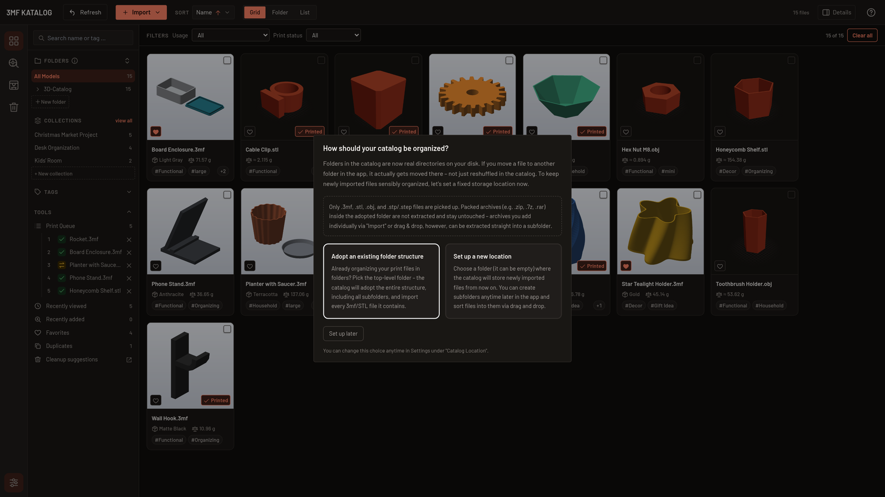

As of this app version, folders in the catalog correspond to real directories on your hard
drive — if you move a file to another folder inside the app, it's actually moved there, not just
re-sorted within the catalog. You have two options:

- **Use existing folder structure** — if you already organize your print files in folders,
  choose the top-level folder. The catalog adopts the complete structure including
  subfolders and automatically imports every `.3mf`/`.stl`/`.obj`/`.stp`/`.step` file it contains.
- **Set up a new location** — a folder where the catalog will store newly imported files from
  now on. Under "Where should the catalog folder go?" your Documents folder is suggested; "Choose
  place …" picks another one. Under "Name of the new folder" you type the name (suggested: "3D
  Catalog"). The line below shows the full path before anything happens; "Create folder and set
  up" creates the folder and uses it. If a folder with that name already exists there, the app
  says so and uses it as it is; if there is a file or a link (shortcut) with that name instead, you
  have to choose another name. Names with characters that aren't allowed in folder names
  (`/ \ : * ? " < > |`) are rejected with a hint. If you'd rather use a folder you already have,
  click "pick an existing folder directly".

You can change this choice at any time in Settings under "Catalog location". The dialog can also
be skipped with the "Set up later" button.

Already-packed archives (e.g. `.zip`) are not picked up by the automatic scan and are left
untouched — unpack them first if needed, or open the folder directly from the catalog via your
file manager afterwards.

## Interface overview

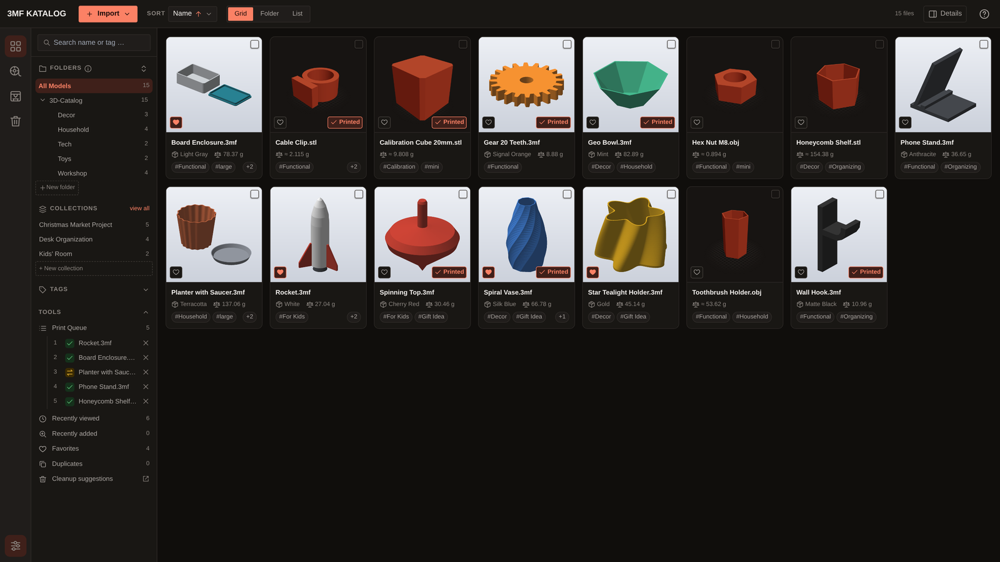

- **Far left, the narrow navigation rail:** switches between the catalog, Printer Manager, Material Manager, and
  the trash (with an item-count badge). The gear icon for Settings sits at the very bottom.
- **Sidebar:** a search field, followed by your folder tree with a model count per folder, your
  collections, your tags, and your print queue.
- **Main area:** your catalog as a grid (tiles with a preview image) or a list, switchable, plus
  sorting and the "Import" button top left.
- **Header:** identifies the current manager area.
- **Detail panel on the right:** opens when you click a model. Under Settings → General →
  "Detail panel", choose "Automatic (appears when clicked)" or "Always visible".
  It shows the preview, metadata and print status. Depending on the model's data, badges also
  show material, filament availability, favorite, queue membership and the last printer used.

## Importing files

The red "+ Import" button top left offers several ways in: pick individual files via a dialog,
import an entire folder (including subfolders), import only the contents of a folder into your
catalog folder ("Folder contents…", see [Importing folder contents](#importing-folder-contents)),
or drag files straight from your file manager
into the catalog window. On import, dimensions, volume, object count, and (if present in the
file) material information are extracted automatically, and the app suggests matching hashtags
that you're free to edit afterwards. Automatically assigned tags such as "multipart", "mini",
"large" and "multicolor" appear in the interface language you selected; search finds them under
both names.

If the app imports a file that's already present in the catalog content-wise (an exact duplicate
check via content hash), it's recognized instead of being added a second time.

The Import menu lists "Files...", "Folder..." and "Folder contents…". A hint box at its top
explains where the files will go while you point at an entry: files selected in the file dialog go
to the active catalog folder or catalog location when one is configured. Without one, they stay in
place. Folder imports and files dropped from outside the app keep their existing locations. The
target is fixed when the import starts — switching folders afterwards does not change it.

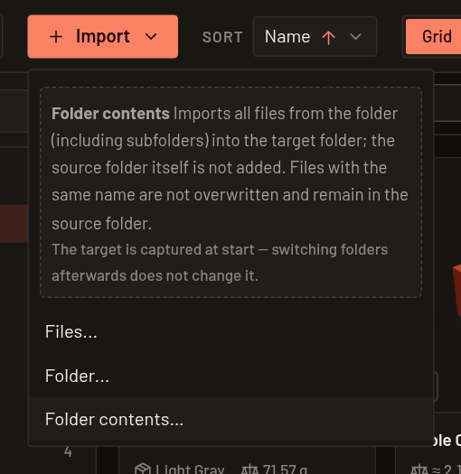

The progress row shows the current stage and offers "Cancel". Files already imported remain in
the catalog. Additional imports wait in a queue; while scanning, the row shows how many files
have been found. After completion, open "Details" to see files that were not imported, their
reasons and files that were imported but could not be placed. "Copy list" copies the result list.

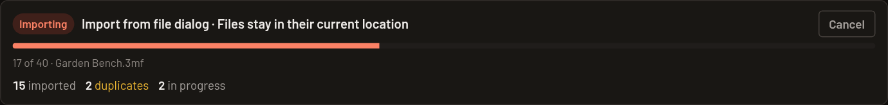

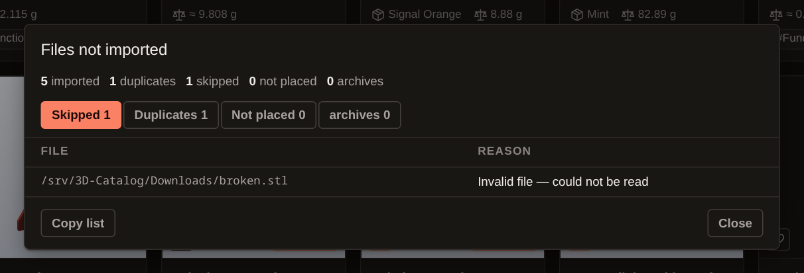

To move catalog models, drag the grip on a card onto a folder. A preview follows the pointer,
valid targets are highlighted, and collapsed folders with subfolders open when you hover over
them. Dropping onto a collection adds the model to that collection.

### Importing folder contents

"Import → Folder contents…" imports all supported files from a folder you choose, including those
in its subfolders, directly into the current target folder — the active catalog folder, or the
catalog location when "All" is selected. In contrast to "Folder...", the structure of the source
folder is not recreated in the catalog and the source folder itself is not added. Files are moved
into the target folder just like with "Files..." (when a catalog location is configured). Files
with the same name are not overwritten and stay in the source folder. Empty source folders are kept
on disk. The progress row names this import "Folder contents".

### Extracting archives

If you import or drag in a single archive (`.zip`, `.7z`, `.rar`, `.tar`, `.tar.gz`/`.tgz`,
`.tar.bz2`, `.tar.xz`, `.tar.zst`) instead of individual model files, a dialog opens before the
actual import:

- **Target folder** — prefilled with the active catalog folder or your storage location, changeable
  via "Change…". Each archive gets its own subfolder inside it. Only catalog folders or a folder
  chosen in one of the app's folder-selection dialogs (e.g. via "Change…") can be the target; folders that contain protected locations — such as your
  home directory itself — are rejected as a target (pick a subfolder instead, e.g. `~/3D-Prints`).
- **Conflict when the subfolder already exists** — choose between "Create new numbered folder" and
  "Merge" (existing files stay unchanged; skipped ones are counted in the result).
- **"Delete archives after extraction" checkbox** — off by default. When enabled, the original
  archive is only deleted if everything was actually extracted. If something was not extracted
  (blocked file types, unsafe entries, or files that already existed when merging), the archive
  stays in place — the result banner names the reason.
- **Grayed-out rows** — archives with no models inside, that are corrupted, encrypted, or in an
  unsupported format are shown grayed out in the list and are automatically skipped during
  extraction.

If checking the archive fails outright (for example because it was changed or deleted in the
meantime), no dialog opens — instead the result banner shows "<name> failed: <error>" until you
dismiss it.

For security reasons, programs, scripts, and shortcuts inside archives are never extracted;
password-protected and multi-part archives are detected but not extracted. If a RAR archive contains a
single file over 1 GB, the whole archive fails (anything already extracted is removed again). File
references in RAR archives (created with `rar -oi`) are not resolved: they are skipped, created as an
empty file, or make the whole archive fail on a checksum error. Folder import still does not extract any archives it contains.

If an archive also contains files that are not models (for example TXT or PDF), they are extracted
too. The result notice and the "Archives" tab under "Details" then say how many other files were
extracted but not added to the catalog (the catalog only shows models) and that they are in the
target folder.

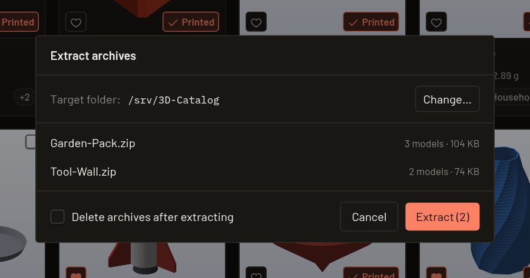

## Browsing and organizing your catalog

Top right, next to "Import", you switch between three views: **grid** (image tiles, see the
screenshot above), **folder**, and **list**:

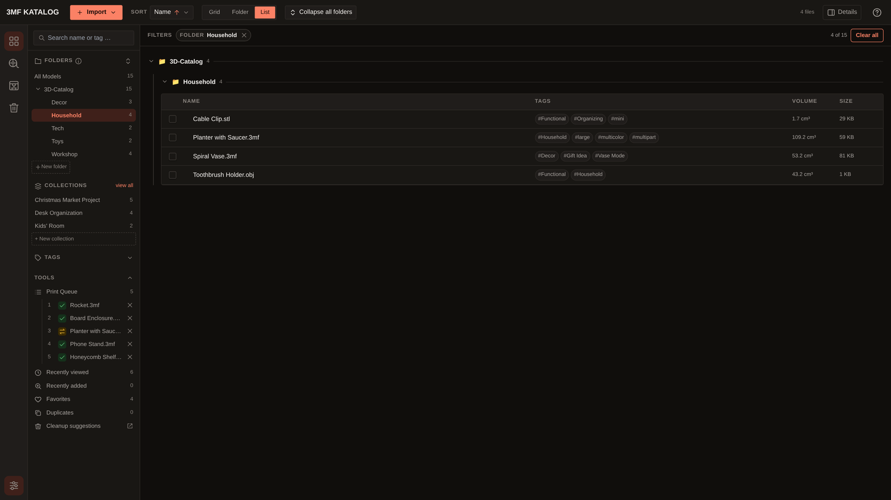

The list shows additional columns (tags, volume, file size) and can be sorted by clicking a
column header.

The filter bar above the models shows the active folder, tag, collection, search, tool view,
usage and print status. Remove individual filters with their close buttons; "Reset filters" clears
them all at once (no models are deleted).

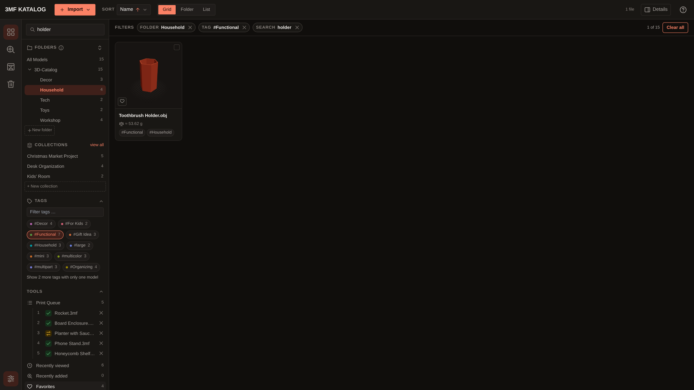

The same bar has two drop-downs: **Usage** ("All", "Commercial use allowed", "Private use only",
"Not specified" — based on the model's [license](#license-and-usage)) and **Print status**
("All", "Printed", "Not yet printed"). Both combine with each other and with folder, tag, search
and the other filters; an active choice also appears as a chip that you can remove.

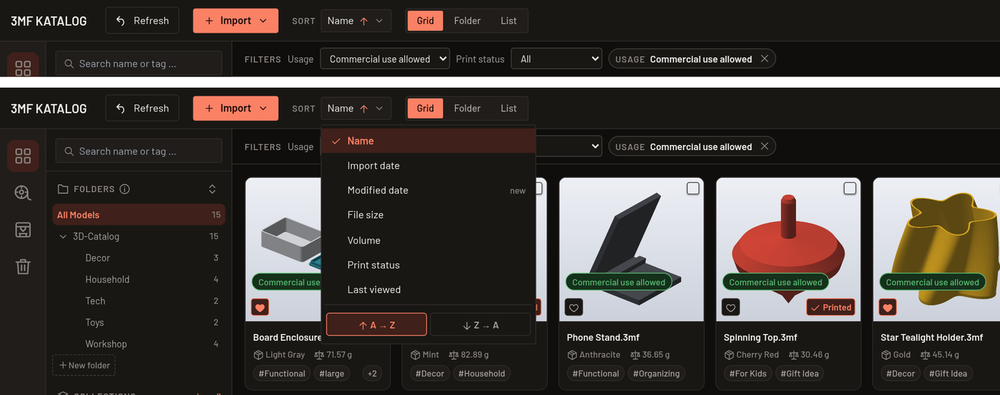

Under "Sort", choose "Name", "Import date", "Modified date", "File size", "Volume",
"Print status" or "Last viewed". Each supports both directions: for example "Oldest first" or
"Newest first" for dates, "A → Z" or "Z → A" for names, and "Not yet printed first" or
"Printed first" for print status. Within each print-status group, models are ordered by name.

In the sidebar, "Filter tags …" searches the tag list. The button below the list also reveals
tags used by only one model. When adding tags in the model details, typing
offers existing tags as suggestions. Colored dots identify tags in the sidebar, detail panel
and detail page. Drag the sidebar edge to change its width. "Collapse all folders" folds up the
tree; icons distinguish folders, collections and tags.

### Folder view

The **Folder** view groups your models by their real folder structure on disk — like a file
explorer, with subfolders indented and a continuous connecting line:

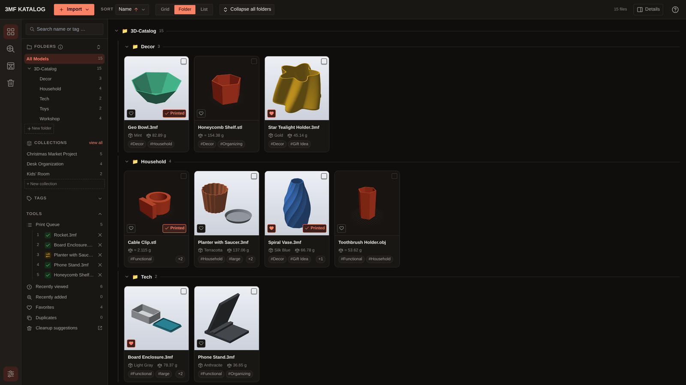

Each folder header shows the total number of files it contains, including all subfolders.
Clicking a header collapses or expands that folder — the state persists across app restarts.
Files with no folder appear as a final "No Folder" section. Both folder headers and individual
files can be dragged directly within this view, exactly like in the sidebar — moving something
here also moves it on disk immediately.

The same grouping is available in list form:

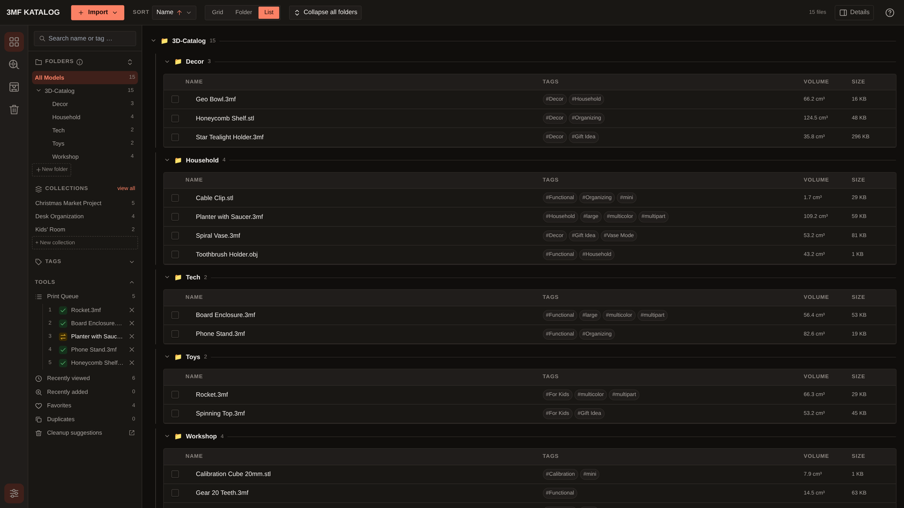

Three independent mechanisms are available for organizing your catalog overall, and you can
combine them freely:

- **Folders** (sidebar, left) — real directories on disk, see above.
- **Tags** — freely assigned hashtags, collected under "Tags" in the sidebar, clickable to
  filter.
- **Collections** — explicitly group several models into a project (see
  [Collections](#collections) below).

The search field at the top of the sidebar filters by name, tag, creator, or file path — a match
in any of these is enough. Press `/` outside text fields to jump into search when single-key shortcuts are enabled.

**Keyboard shortcuts:** `/` focuses search, the arrow keys navigate the grid spatially (Up/Down
jumps to the next row based on actual rendered tile position, Left/Right to the next/previous
model), Space toggles the multi-select checkbox of the currently selected model, and Delete/
Backspace opens the delete confirmation when a multi-selection is active (see
[Multi-select](#quick-actions-context-menu-and-multi-select)). None of these fire while you're
typing in a text field.

Tab navigation has a visible focus indicator. Ctrl+A (Cmd+A on macOS) selects all visible
models. Escape clears the selection or closes a menu or dialog; in search it leaves the field
without clearing the query. Open "Keyboard shortcuts and tips" with `?`, the help icon in the
header or Settings → Info. Settings → General → "Single-key shortcuts" disables shortcuts
such as `/` and `?`; Ctrl/Cmd shortcuts remain available.

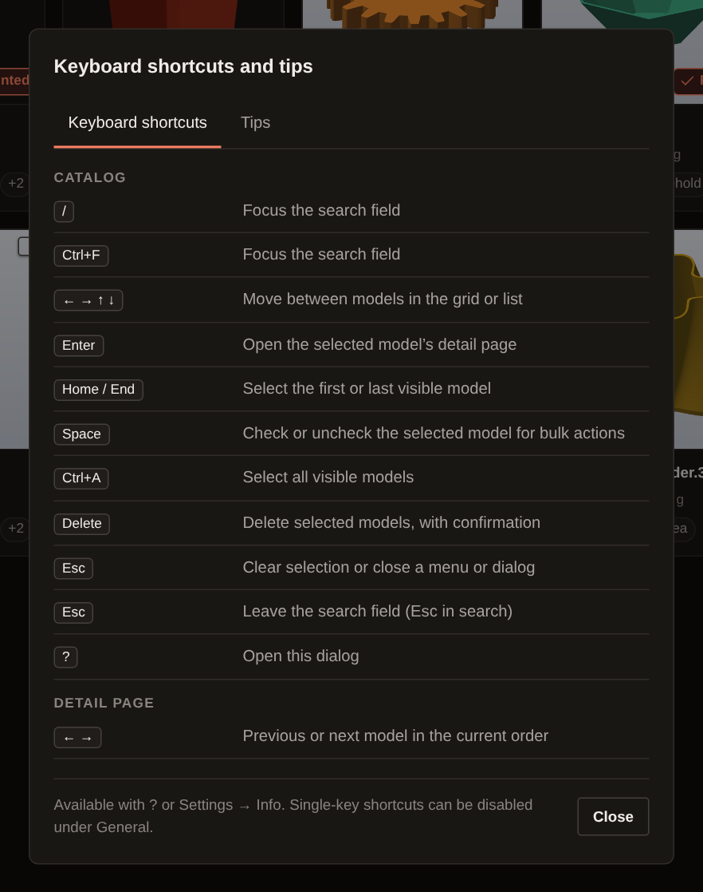

### Syncing with the disk

If you add, move or delete files in your catalog folders outside the app (for example in your file
manager), **Refresh** brings the catalog up to date. The button sits in the header next to
"Import" and is only there in the catalog view; **F5** does the same while no dialog is open.
Pointing at the button shows when the catalog was last checked ("Never" if it hasn't been yet). It
is disabled while an import is running.

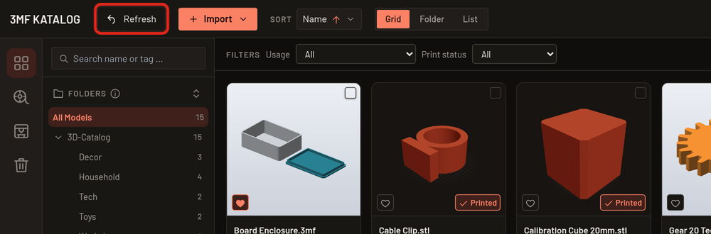

Refresh first only looks — nothing changes until you confirm:

- **Everything matches:** a short notice "Everything is up to date" appears at the bottom of the
  window.
- **Otherwise** the "Sync with disk" dialog opens. It counts "new files", "new folders" and
  "missing files" and lists them under "New on disk" and "No longer on disk" (the path inside the
  catalog folder, with the catalog folder below it). New folders appear only when they contain new
  supported files; empty folders are left out. "Apply changes" adds the new files and folders to
  the catalog, "Later" closes the dialog without changing anything.
- **Missing files are kept by default.** Their entries stay in the catalog and still show up in the
  catalog check (Settings → Catalog). To remove them, tick "Remove missing files from the
  catalog"; the button then offers "Apply changes" (with new files) or "Remove" (only missing
  files). Removed entries go to the [trash](#the-trash), so you can still restore them;
  notes, tags and usage are lost once they are deleted permanently from there.
- **Nothing to apply:** if there are no new files or folders and you have not ticked the removal
  option, the dialog only offers "Close".
- **Folders that cannot be read** are listed with their paths ("N folders could not be read"); the
  rest is still compared. **Files that cannot be read** are skipped and shown with their paths
  after applying ("N files could not be read"); all readable files are imported anyway.
- **Unreachable catalog folder** (for example a network drive or USB drive that is not connected,
  or an empty or unmounted folder): the sync stops with "A catalog folder is unreachable. Please
  check the connection. Remove the folder from the catalog or reconnect it." and the path, and
  the catalog stays unchanged. Files on such a folder are never treated as missing. "Try again"
  repeats the check. Other messages: "The catalog has changed. Please scan again." (something
  changed between preview and applying), "A path has changed. Please scan again.", "A file could
  not be imported. The catalog is unchanged." and "The sync failed. Please try again."
- **After applying,** a notice sums up "N new files · N new folders · N files removed", and the new
  entries are briefly highlighted.

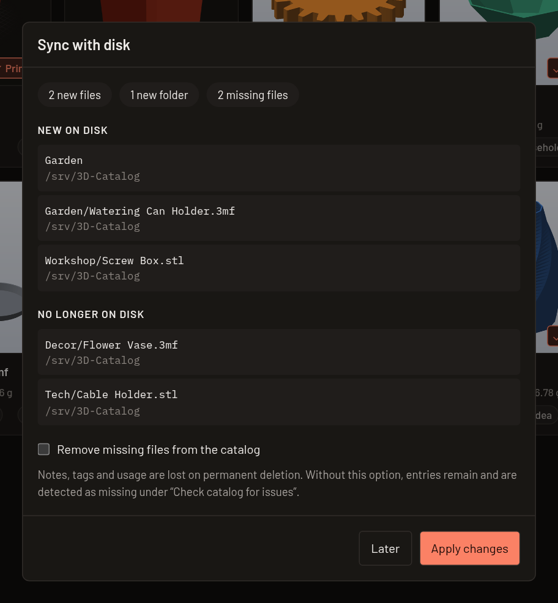

## Viewing a model in detail

Double-clicking a model opens the full detail page:

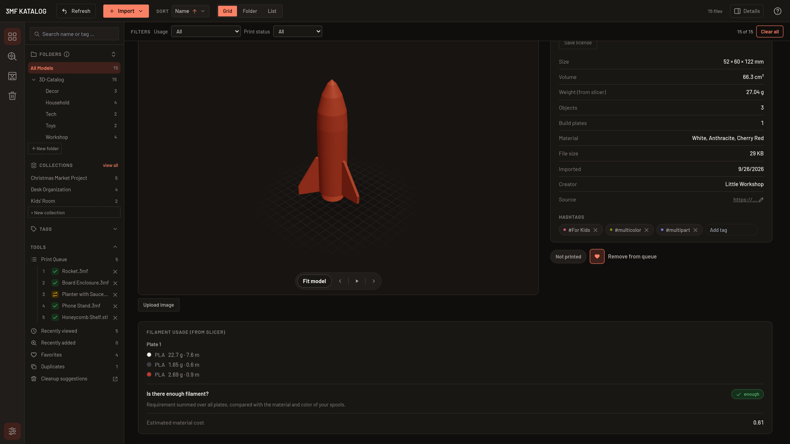

Top right in the preview area, you switch between the **3D view** (free rotation by dragging with
the mouse, plus auto-rotation and 15°-step buttons) and the stored **image** — which of the two
is shown by default is set in Settings under "Preferred view". On the right you'll find all
metadata (dimensions, volume, estimated weight, material, file size, import date, creator),
followed by a **source** field (e.g. a link to the model's origin page) and your hashtags, with
the option to add or remove more. If the file has already been sliced in OrcaSlicer or Bambu
Studio, the app reads the real filament weight straight from the slicer's metadata instead of
only roughly estimating it — including a breakdown per print plate and filament, plus an
estimated material-cost total if matching spools are on record in the Material Manager. The
"Re-scan metadata" button re-fetches these values later on, in case you sliced an already
cataloged file after the fact.

At the bottom left you can mark the model as **printed** and add it to the **queue**. The **heart**
marks it as a favorite; you find all favorites under "Tools → Favorites".

Use "Previous model" and "Next model", or the Left/Right arrow keys outside input fields,
to move through the current model order. The position is shown beside the buttons. If edits
are pending, choose "Keep editing" or "Discard and switch" before changing models.

The 3D preview offers "File colors" when color data is available, or "Single color".
Color data are standard 3MF materials or, for Bambu Studio and OrcaSlicer projects, the filament
of each part and painted areas; a subdivided painted triangle shows its main color. If a file has
colors the preview cannot show, the 3D view says so in a short note.
The legend explains the file colors. For multi-plate 3MF files from Bambu Studio, OrcaSlicer or
Creality Print, the plate bar below the preview reads "All", previous arrow, plate numbers, next
arrow. Pointing at a number shows "Plate n" and the plate's name. Selecting a plate fits it into
view and limits the legend to that plate; the Left/Right arrow keys step through the plates while
the bar has focus, and at the first or last plate the arrow turns grey. With more than 12 plates
the numbers are replaced by a counter such as "3 / 14" with the plate name.

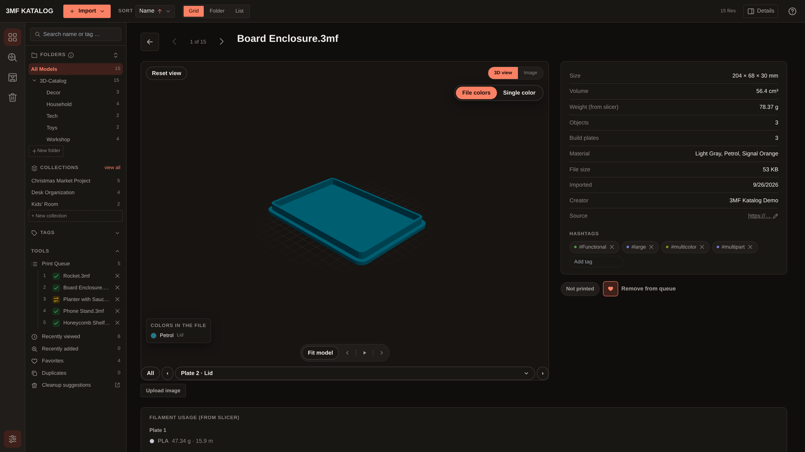

"Show in file manager" reveals the file from the detail page, detail panel or card context menu.
On macOS it reads "Show in Finder", on Windows "Show in Explorer".

If the 3D preview cannot be shown, a card in the preview area explains why instead of leaving it
empty (the stored image stays visible behind it when there is one):

- **"The file was not found"** — check its location or remove the entry from the catalog. The card
  shows the path and offers "Open in file manager" and "Remove from catalog".
- **"The file cannot be read"** — it is damaged, locked or has no displayable geometry; check
  whether another program has it open. The card offers "Open in slicer".
- **"The model is too large for the 3D view"** — it exceeds the app's limits (for example binary
  STL files with more than 3 million triangles, ASCII STL files over 256 MiB, OBJ files over
  128 MiB, or 3MF models over 3 million triangles). Use the preview image or open it in your
  slicer.
- **"The 3D view is not supported on this computer"** — WebGL is unavailable. Use the preview image
  or open the file in your slicer.
- A file type without a 3D preview shows "This file type has no 3D preview". For unexpected
  errors the card also offers "Report problem".

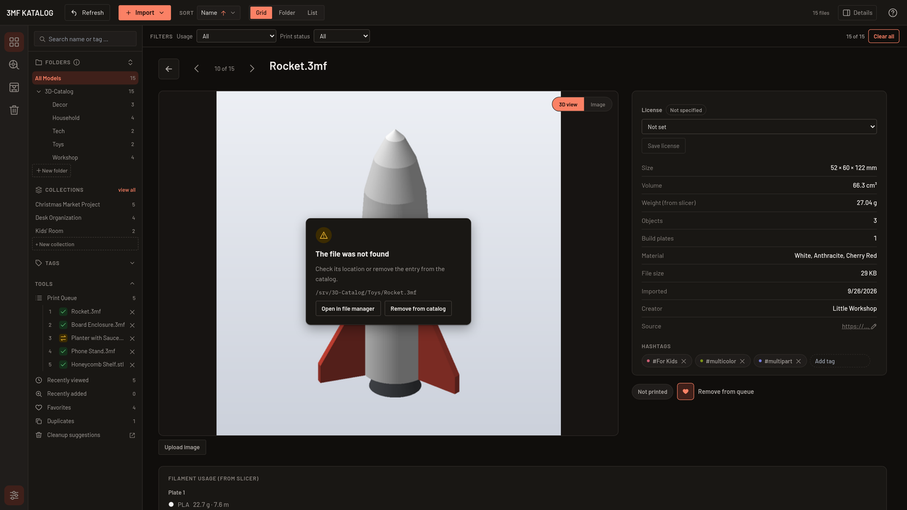

### License and usage

Each model can carry a **license**. In the detail panel and on the detail page, the "License"
section has a drop-down. Its choices are "Not set", the Creative Commons presets (CC BY, CC BY-SA,
CC BY-NC, CC BY-NC-SA, CC BY-ND, CC BY-NC-ND, CC0), "Personal use only", "Commercial use allowed /
license purchased", "Own design" and "Other…". "Other…" opens a free text field "License text"
(up to 200 characters). "Save license" stores it; on the detail page, a changed, unsaved license
counts as an unsaved change and asks before "Next model" discards it.

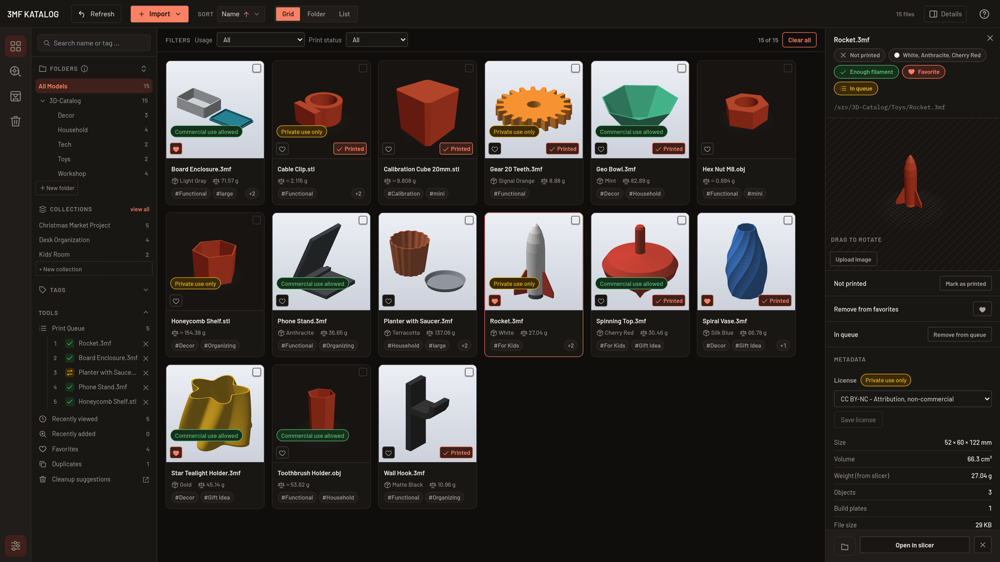

From the license, the app derives a **usage** badge: "Commercial use allowed" (CC BY, CC BY-SA, CC
BY-ND, CC0, "Commercial use allowed / license purchased" and "Own design"), "Private use only" (CC
BY-NC, CC BY-NC-SA, CC BY-NC-ND and "Personal use only") or "Not specified" (nothing set, or a free
text). The badge appears on grid cards and list rows — not for "Not specified" — and, including
"Not specified", next to the license field. Use the **Usage** filter to narrow the catalog (see
[Browsing and organizing your catalog](#browsing-and-organizing-your-catalog)).

To set the license of several models at once, select them and use "Set license" in the action bar
of the multi-selection (see [Quick actions](#quick-actions-context-menu-and-multi-select)). It
opens the same drop-down and applies the choice to all selected models. Existing tags are not
changed.

## Quick actions: context menu and multi-select

Right-clicking a model opens a context menu with the most important actions:

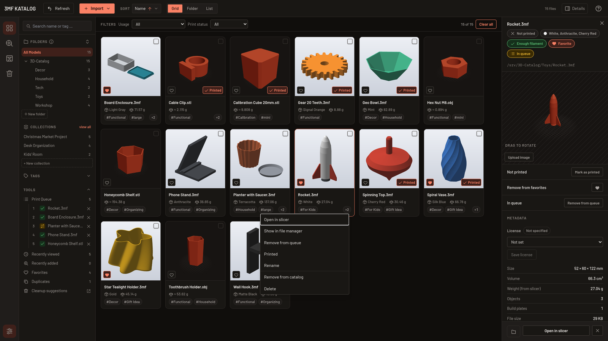

Use "Rename" to change the file name right in the context menu — the file extension is shown
fixed and can't be typed away. If the new name moves the model out of the visible area
under the default name sort, the view scrolls to it automatically.

To edit several models at once, select them via the checkboxes at the top left of each tile (or
"Select all"). An action bar appears, letting you add the whole selection to the queue or a
collection, add or remove a tag ("Add tag" / "Remove tag" — the latter shows a dropdown listing
every tag present in the selection), mark it printed/not printed, or delete it together. With a
multi-selection active, the Delete/Backspace key also opens the delete confirmation directly:

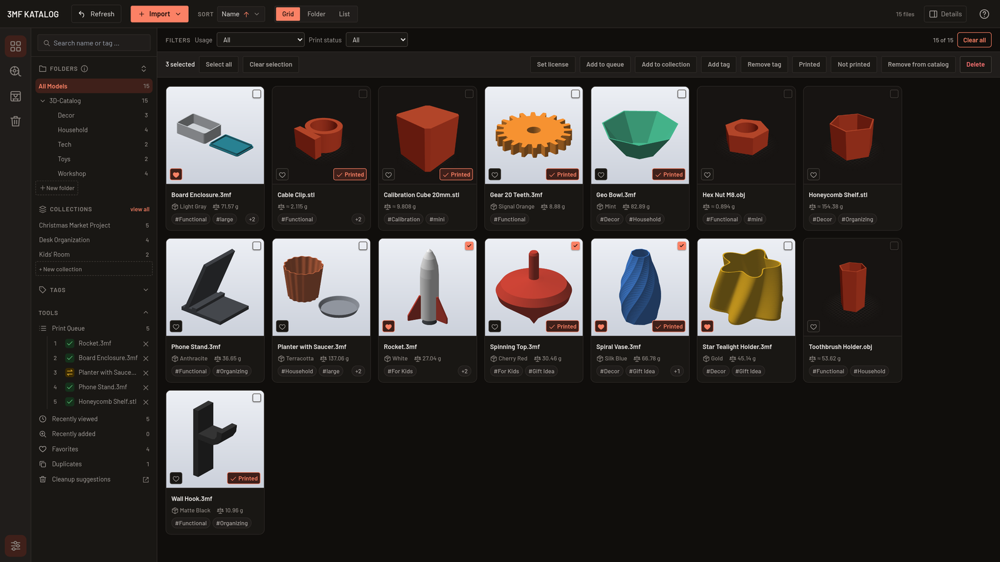

### Remove from catalog

Use **Remove from catalog** in a model's context menu or in the selection bar to remove
catalog entries. The confirmation names the model or shows the number of selected models.
Confirm with **Remove**. The files on disk stay unchanged; the models are not moved to the trash.

Right-click a folder and choose **Remove from catalog** to remove it and its catalog subtree.
The confirmation shows the folder name, the number of subfolders (excluding the selected folder),
and the number of models in the whole subtree (excluding trash entries). Removing them also
removes their tag assignments and print log entries. Folders and files on disk stay unchanged,
and you can import them again later. Existing trash entries are kept.

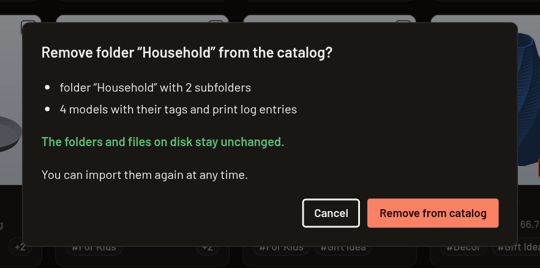

Removing the catalog location folder or one of its ancestors in the catalog is refused. The
message reads:

> This is the catalog location. To empty it, use “Reset catalog” in Settings.

## Collections

Collections are a third organizational mechanism alongside folders and tags: you explicitly
group several models into a project, with a manually definable order (drag & drop). Create a new
collection via "+ New collection" in the sidebar and populate it via multi-select. Clicking a
collection in the sidebar filters the catalog down to its models:

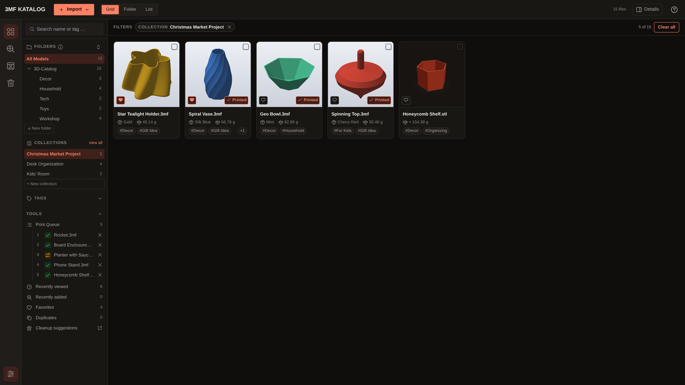

Right-click a collection in the sidebar to choose "Rename" or "Delete". Drag models onto a
collection to add them. The back button leaves the collections gallery.

## Tools in the sidebar

At the bottom of the sidebar, the **Tools** section bundles several helpers, each with a count.
Click its heading to collapse it.

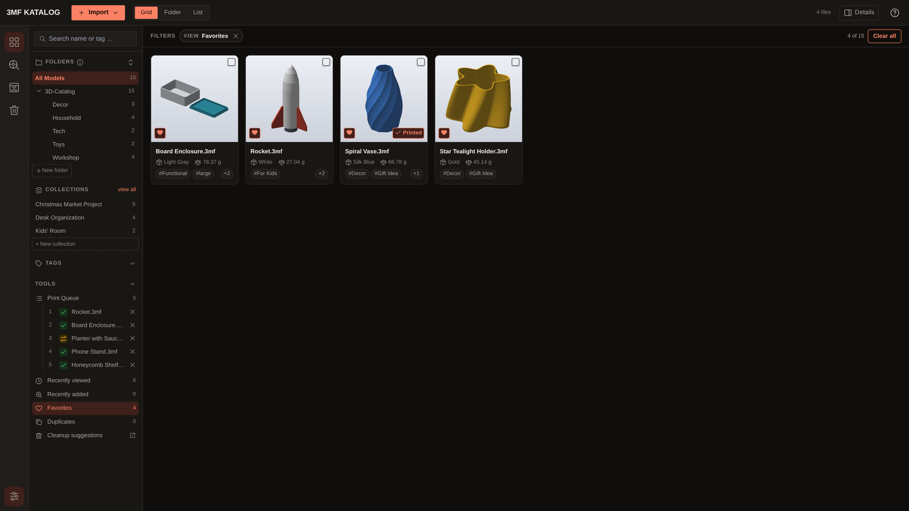

- **Print Queue** — models you plan to print next. Collapsible and sortable via drag & drop;
  clicking an entry shows the model. An icon per entry tells you whether your filament is enough
  (see [Is there enough filament?](#is-there-enough-filament)). Marking a model as printed automatically removes
  it from the queue.
- **Recently viewed** — the 20 most recently opened models, newest first.
- **Recently added** — everything imported in the last 7 days.
- **Favorites** — all models you marked with the heart, sorted alphabetically.
- **Duplicates** — models with identical file content, shown side by side as groups.
- **Cleanup suggestions** — checks the catalog for missing files and duplicates.

A selected view appears as a filter chip at the top and can be combined with folders, tags and
search. Clicking the view again or the ✕ on the chip removes it. Printer Manager, Material Manager and trash are
still reached via the icons in the left rail.

## Opening models directly in your slicer

"Open in slicer" (available in the detail panel, on the detail page, and in the context menu)
launches your slicer program directly with the selected file. Which slicers are available, and
which of them is your **default slicer**, is configured in Settings (see below).

> On macOS, this works reliably for automatically detected slicers. If you add a slicer
> manually instead, you need to select the program file **inside** the `.app` bundle in the
> picker (not the bundle itself) — see [Known limitations](#known-limitations).

## The Material Manager

The Material Manager is an independent manager for your filament spools, separate from the model
catalog. You reach it via the second icon in the navigation rail on the far left.

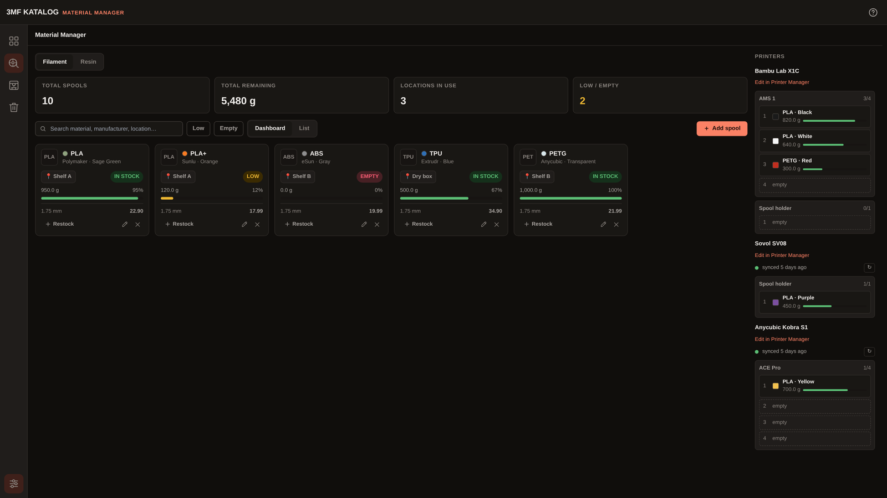

At the top is a stats bar (total spools, total remaining weight, occupied storage locations,
spools with low/empty stock). Each spool card shows material, manufacturer, color, storage
location, remaining weight as a bar and percentage, and a status: **In stock** (green), **Low**
(orange, once stock is running low), or **Empty**. The "Low"/"Empty" filter buttons or the search
field help you find spools that need reordering soon.

As an alternative to the tile view, there's a sortable list view ("List" next to "Dashboard"):

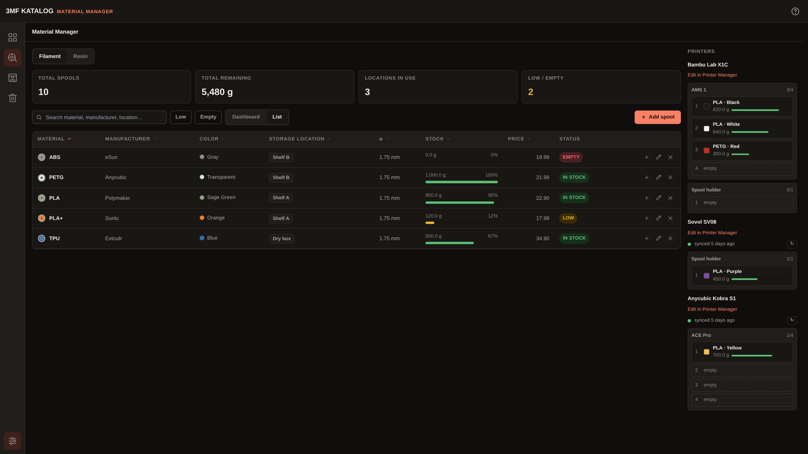

"+ Add spool" opens the form for a new spool:

Besides the usual fields (material, manufacturer, color, storage location, diameter, price,
original/remaining weight, optionally a photo), you can also set a **quantity** here: adding,
say, three identical PLA spools at once still gives each one its own, independently tracked
remaining weight. Weights are stored to 0.1 g. For material, manufacturer, and storage location,
the app suggests previously used values as you type (autocomplete). Pick the photo by clicking
the image field, or drag it straight from your file manager onto the field (one PNG, JPG or WebP
file, up to 5 MB). If an image doesn't fit, the notice appears right below the image field and
the form stays open when you save: choose another image or close the notice with ✕ to save
without it.

**Edit with a double-click:** Double-clicking a card or a row in the list opens the same form as
the pencil ✎.

**Restock:** When you've bought more of a spool you already have in stock, click "＋ Restock" on
its card (in the list: "＋" in the row). In the small window, choose the quantity (1 to 20) and
adjust amount, price and storage location if needed. They are prefilled from the template; the
storage location is its home location if it currently sits in a printer. The new entries copy
type, material, manufacturer, color, color value, image and diameter, are full and go to storage.
Afterwards they get a brief green outline. Escape or a click outside the window closes it without
adding anything.

**Resin:** Use "Filament | Resin" at the top of the stock to switch to your resin bottles; the
app remembers your choice. Overview, list, search and stats then show only resin, with amounts in
milliliters ("Total bottles"). "Add bottle" there always creates a resin bottle, while the
filament area always creates a spool. Instead of the weight you enter the "Volume (ml)", there is
no diameter, and material and manufacturer suggest resin values. When you've used resin, click
"− Use" on the bottle and enter the milliliters (to 0.1 ml); the remaining amount never drops
below 0. Resin bottles never go into a filament slot, only into the resin vat of a resin printer
(see [Resin printers](#resin-printers)), and are left out of "Is there enough filament?" and the
material cost.

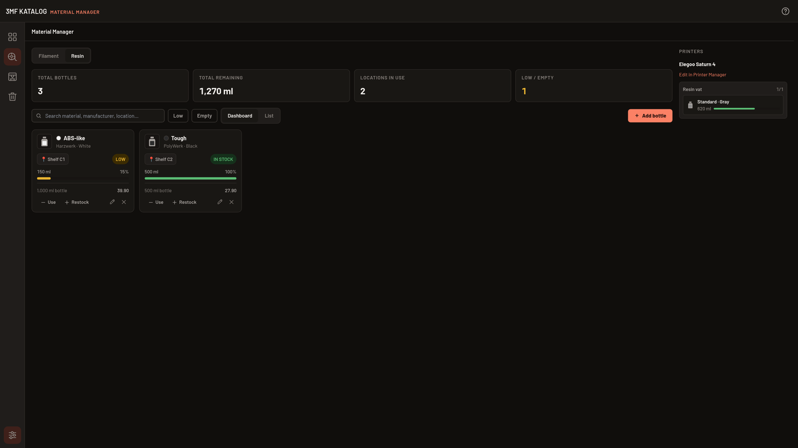

### Is there enough filament?

For 3MF files sliced in Bambu Studio or OrcaSlicer, the detail page compares the filament needed
(summed over all plates) with your spools: same material and similar color. For each filament
you see a status:

- **enough** — a matching spool has enough remaining weight,
- **enough with spool change** — only enough if you load a second spool along the way,
- **not enough** — with the missing amount,
- **unclear** — no matching spool found or no slicer data.

The app also names the matching spool with its remaining weight and tells you whether it is in a
printer (printer · unit · slot) or where it is stored. The print queue shows the same status as an
icon and calculates top to bottom with the combined need. Nothing is deducted.

### Printers & AMS

Open "Printer Manager" in the left rail to manage printers. Select a printer and use "Edit"
to change "Name", "Manufacturer", "Model", "Nozzle" (filament printers) and
"Build volume X × Y × Z". "Material assignment" manages the units, "Connection & network"
sets up the printer link, and "Recent prints" shows its print history.
Loading spools or resin bottles and confirming new prints remain in Material Manager.

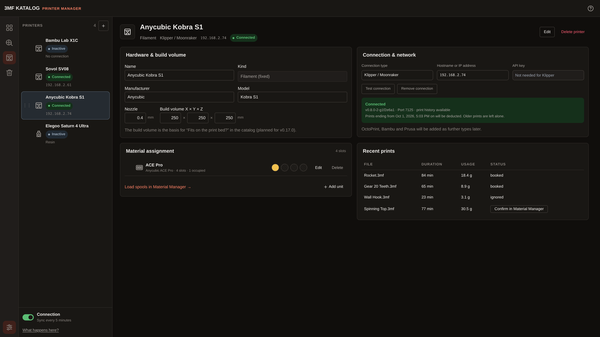

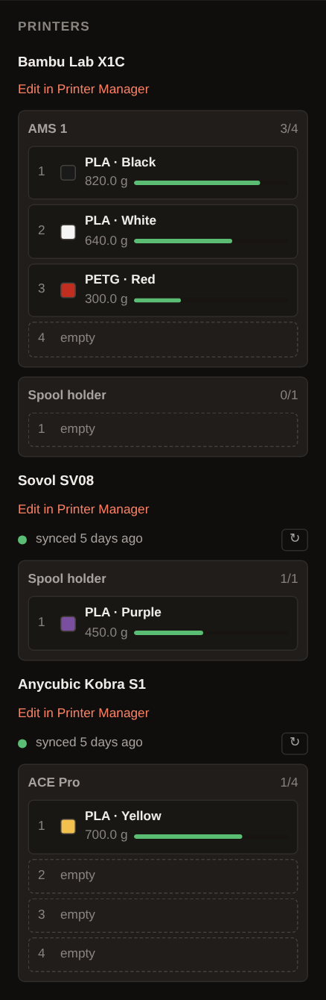

1. In Printer Manager, use "+ Add printer" to add a printer — next to the name you choose "Filament" (default)
   or "Resin"; the kind can't be changed afterwards. A filament printer automatically gets a
   "Spool holder" unit (1 slot); for a printer without an AMS this is initially its only slot, but you can delete it
   at any time. Then add more multi-material units to it via "+ Add unit" — either from
   templates (Bambu AMS/AMS lite/AMS HT, Creality CFS, Prusa MMU3, Anycubic ACE Pro, Spool
   holder) or as "Custom…" with any slot count you like. Reorder units by their drag handle. If
   a printer ends up with no slots at all (e.g. after deleting its spool holder), its column
   shows the hint "No slots – add them in Printer Manager"; clicking it opens printer
   management directly.
2. In Material Manager, load a spool by dragging a card or row from the stock onto a slot — or click the slot and pick
   a spool from the list. If the slot is already occupied, the spool already in it returns to
   its home location.
3. Unloading: drag the spool from the slot back into the stock area, or choose "Unload" from
   the slot's menu. It automatically returns to its home location; the notice lets you change
   that location.
4. The spool form now has a **color value** (palette or hex input) in addition to the color
   name; for a loaded spool, the storage-location field is labeled "Home location".
5. Which spool is in which slot is still something you enter by hand here (drag & drop or the
   slot menu). What the app can take off your hands is reading the filament used after a print
   on connected Klipper/Moonraker printers — see [Printer connection](#printer-connection).

In the "Filament" view the right-hand column only shows filament printers, in the "Resin" view
only resin printers.

### Resin printers

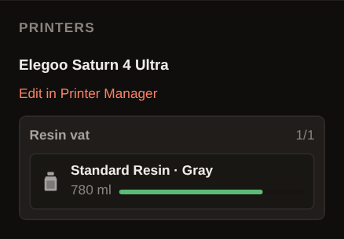

If you choose "Resin" when adding a printer, it gets exactly one **resin vat** with room for one
bottle instead of the spool holder. The vat can't be renamed or deleted, and resin printers
can't have any other units; the printer itself can be renamed and deleted like any other.

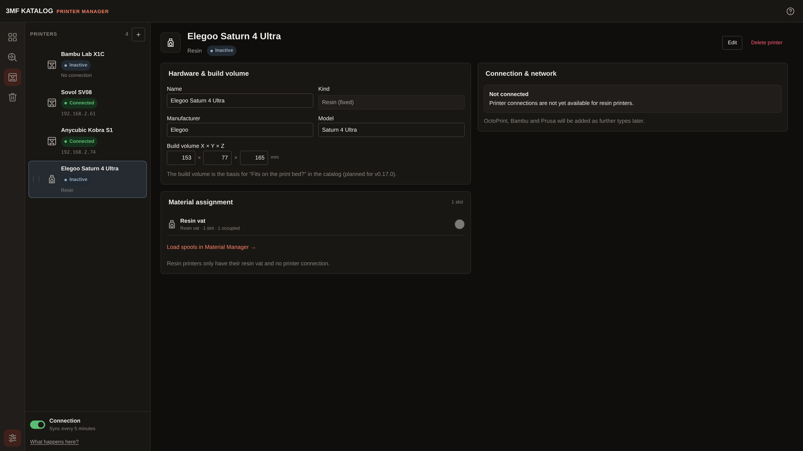

- In the "Resin" view of the stock, the resin printer appears in the right-hand column. The vat
  shows the inserted bottle with its color, the remaining ml and a fill bar.
- To insert a bottle, drag its card or row onto the vat, or click the vat and pick a bottle —
  the menu only lists resin bottles. If the vat already holds a bottle, that one returns to its
  home location.
- "Unload" (vat menu, or drag it back into the stock area) returns the bottle to its home
  location, just like spools.
- "− Use" is available for an inserted bottle in the vat's menu.
- Resin bottles only fit into a resin vat, filament spools never do. A target that doesn't fit
  isn't highlighted while dragging, and dropping there does nothing.
- Resin printers have no printer connection and are left out of "Is there enough filament?",
  the material cost and the queue icon.
- A bottle in the vat keeps its kind: you can only change it to filament after unloading it
  (and the same goes for spools in a slot).

### Printer connection

With a Klipper printer running Moonraker (e.g. controlled via Mainsail or Fluidd), the app can
read the filament used by finished and aborted prints itself, instead of you entering it by
hand. This is **off by default** and read-only: the app only sends queries, never a command, and
only talks to addresses you enter yourself on your home network.
Resin printers cannot be connected; "Connection & network" shows a notice instead of connection controls.
The connection has been tested with a Sovol SV08, an Anycubic Kobra S1 running Rinkhals and a Qidi Smart 3. Other
Klipper printers should work the same way; if you want to test yours, the
[test page](https://3mfkatalog.de/en/printer-test.html) helps.

1. **Printer Manager** → switch on "Connection" at the bottom of the printer list.
2. Select the printer → "Connection & network" → enter the address (the same IP or name you'd use to open Mainsail in a browser) → "Test
   connection". If it works, the app shows the version and port, plus the point in time from
   which prints will be deducted — older prints are left alone. If the printer reports "Login
   required", it has a login set up that this version doesn't support yet. If the printer's
   clock is wrong (no time sync), a note "The printer's clock is wrong" shows both times: the app
   corrects the difference automatically, but it's better to turn on time sync (NTP) on the
   printer.
3. After that, the app automatically asks the printer for newly finished prints at startup,
   every 5 minutes, and via the "↻" button next to its status. If there are any, the Material
   Manager shows the hint "N new prints waiting for confirmation" with a "Review" button.
4. In the "New prints" dialog that opens, you see the usage in grams per print, plus a
   suggested spool (the one loaded in the printer, if known) and a suggested catalog model
   (matched from the file name) — both can be changed. Only "Confirm" (individually or via
   "Confirm all N") deducts the weight from the spool; with a model selected, this also adds a
   print log entry and marks the model as printed. "Ignore" discards the suggestion without
   booking anything.

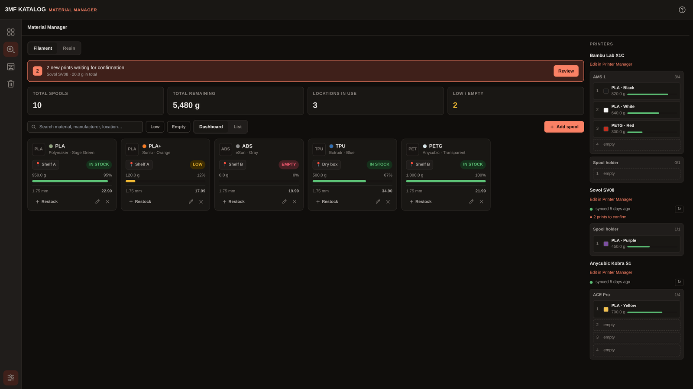

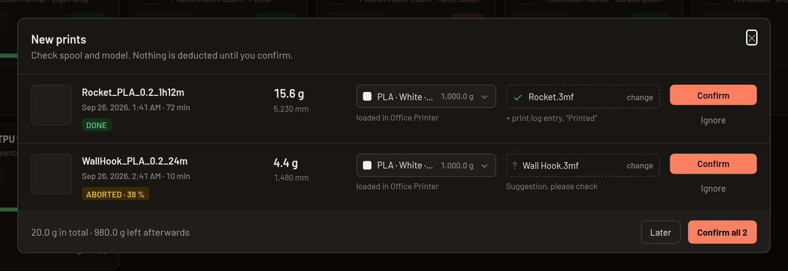

## Print log

In addition to the simple printed/not-printed status, you can keep a log of multiple print
attempts per model (date, a note, optionally a photo) — useful if you print the same model
repeatedly and want to keep track of which attempt worked and when.

## The trash

Deleted models aren't removed immediately — they move to the trash for 7 days and can be restored
during that time:

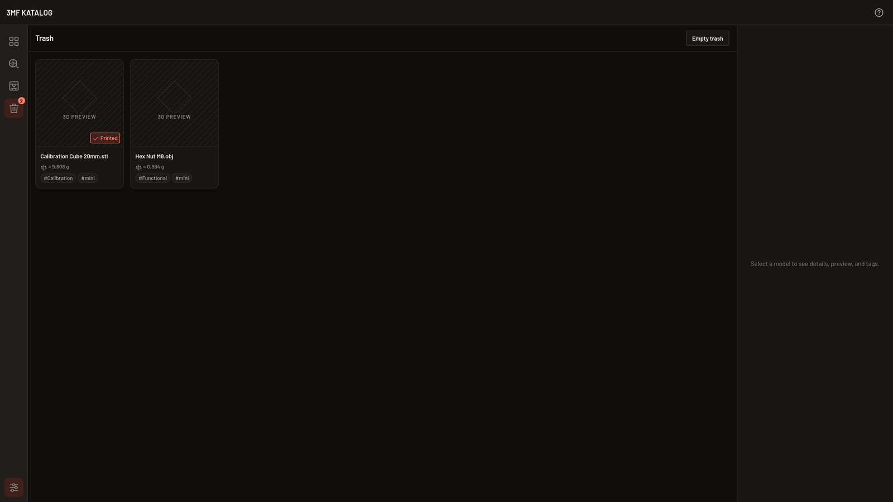

"Empty trash" top right removes everything it contains immediately and permanently.

## Settings

The gear icon at the bottom of the navigation rail opens Settings. They're split into four tabs:
**General**, **Slicer**, **Catalog**, and **Info**.

### General

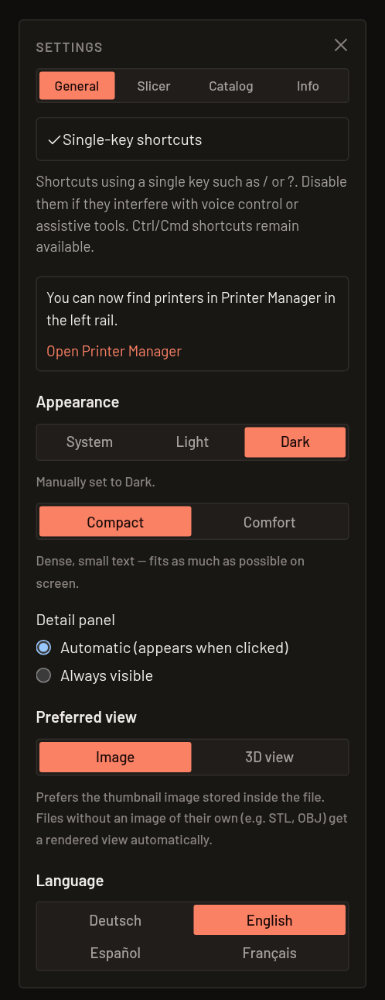

- **Appearance** — follows your system setting automatically, or fixed to light/dark. Right below
  it, the density setting: "Compact" (dense, small text, a lot at a glance) or "Comfort" (larger
  text, graphics, and controls, noticeably easier to read).
- **Preferred view** — whether the catalog and the detail page default to the stored preview
  image or the rendered 3D view. Missing snapshots are rendered automatically in the
  background, one file after another. With "Image", this happens for files without an image of
  their own (e.g. STL, OBJ).
- **Language** — German, English, Spanish, or French, effective immediately without a restart.

### Slicer

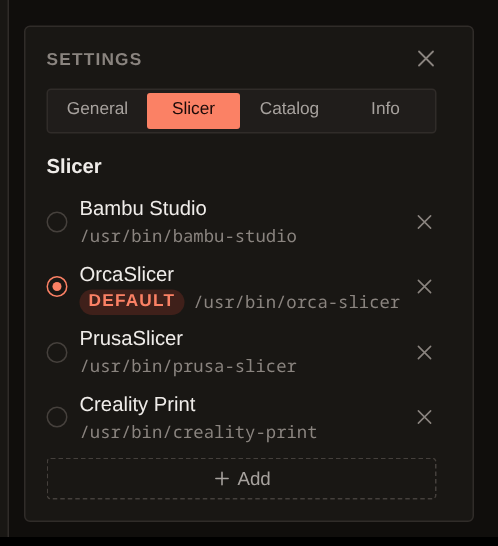

The app scans known install locations on startup (Bambu Studio, OrcaSlicer, PrusaSlicer,
SuperSlicer, UltiMaker Cura, Creality Print) and adds any it finds automatically; use "+ Add" to add others,
including self-built or modified versions. The radio button sets which slicer is used as the
**default** when opening a model.

### Catalog

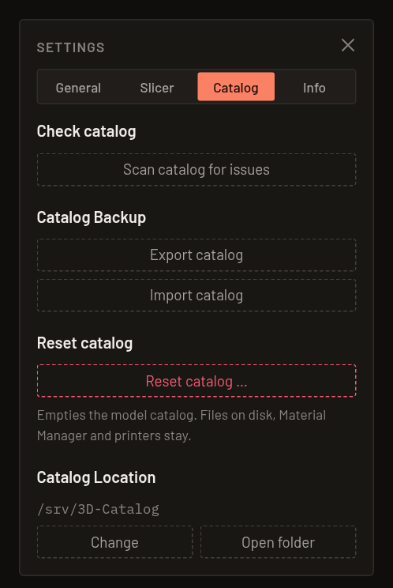

- **Check catalog** — a manually triggered scan finds orphaned file paths (a file listed in the
  catalog but no longer present on disk) and inventory duplicates, with cleanup via a selection
  dialog.
- **Catalog backup** — see the next section.
- **Catalog location** — shows the current base directory and lets you change it or open it
  directly in the file manager. Changing it opens the same dialog as the initial setup.

#### Reset catalog

Under Settings → Catalog, **Reset catalog …** opens a confirmation with the number of models
outside the trash and the total number of catalog folders. **Reset** clears those models and
folders, all tags and collections, and the removed models' metadata, queue entries and print log.
Files and folders on disk stay unchanged.

Trash entries remain, but lose their folder, tag and collection assignments. Filament and resin
stock, printers and their connections, printer jobs, slicers and other settings are kept.
Printer jobs lose their links to catalog models, including models in the trash.

Use **Back up first …** to export a catalog backup before resetting; **✓ Backed up** confirms
success. The backup is optional. After resetting, the setup dialog opens again so you can set up
the catalog location anew.

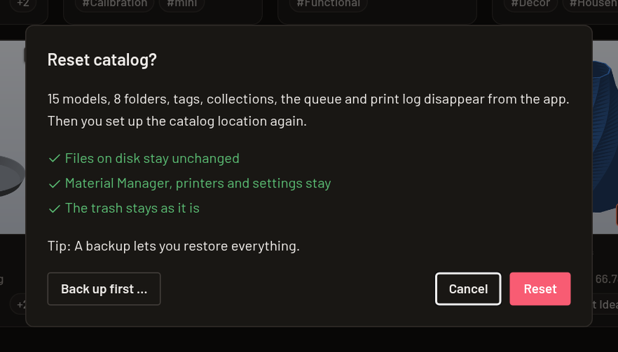

### Printers

Under General, "Open Printer Manager" takes you to the printer area in the left rail.
There is no separate Printers tab. The connection switch is at the bottom of the printer list;
addresses and connection tests are in the selected printer's "Connection & network" section
(see [Printer connection](#printer-connection)).

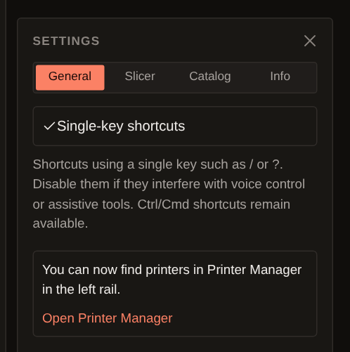

### Info

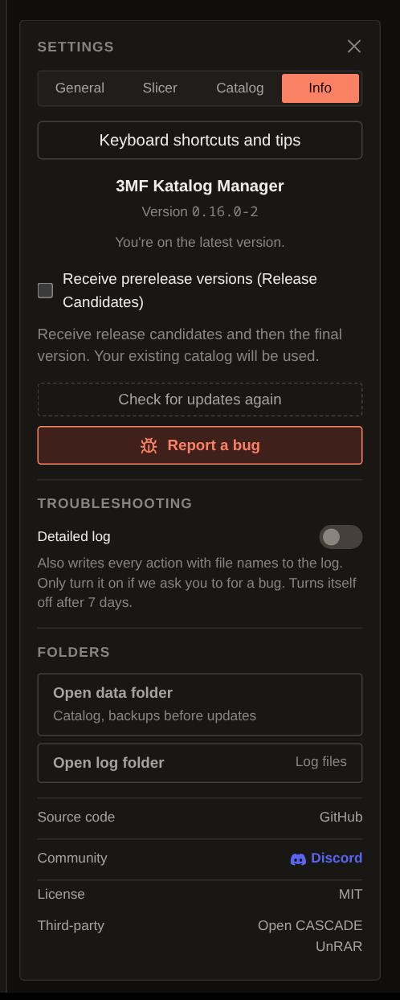

Shows the installed version, the MIT license, and links to the source code, Discord and third-party
licenses, and the same update information described in [Updating](#updating) below: whether a
newer version is available, a "Check for updates again" button for a manual check, and — after
installing one from within the app — the date and backup file name of that update.

The check button shows **Checking…** while checking; afterwards the tab shows the result or a
check failure. **Report a bug** and **Detailed log** are also here (see [Reporting a bug](#reporting-a-bug)).

Under **FOLDERS**, **Open data folder** opens the folder with your catalog and the backups taken
before updates (`update-backups`), and **Open log folder** opens the folder with the log files.
There are two buttons because on Windows and macOS the log files are kept in a different system
folder than the catalog.

The following screenshots compare the **light** and **dark** themes:

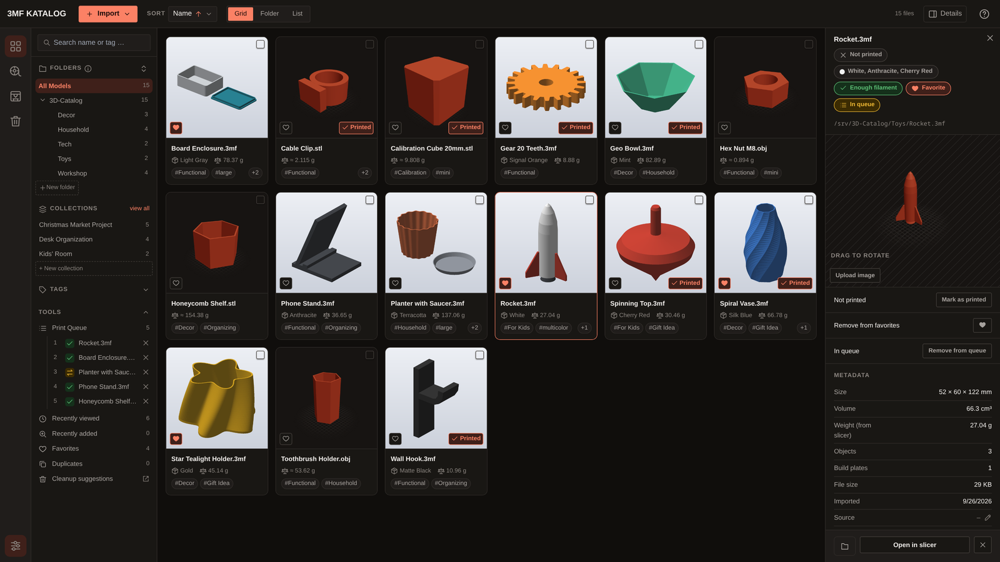
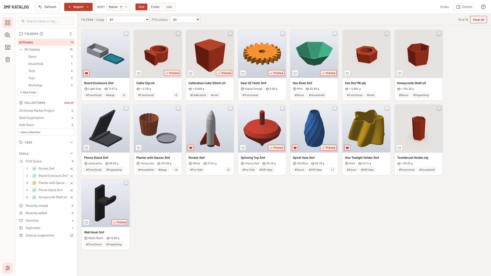

Under Settings → Info, the checkbox "Receive prerelease versions (Release Candidates)" enables
release candidates and the later final version for your existing catalog. Ticking it opens a
warning: a catalog migration may prevent returning to an older version without a backup. Choose
"Export catalog now", then "Enable now" after the export succeeds; "Enable anyway" proceeds
without that export, and "Cancel" leaves the checkbox unticked. Unticking it again does not
uninstall an existing prerelease; it stays installed until a newer stable version is available.

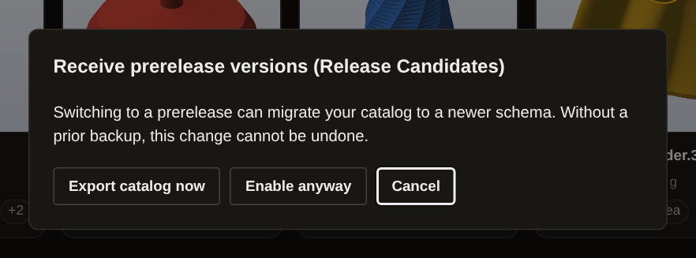

The app runs only once. Launching it again brings the existing window to the front.

### Reporting a bug

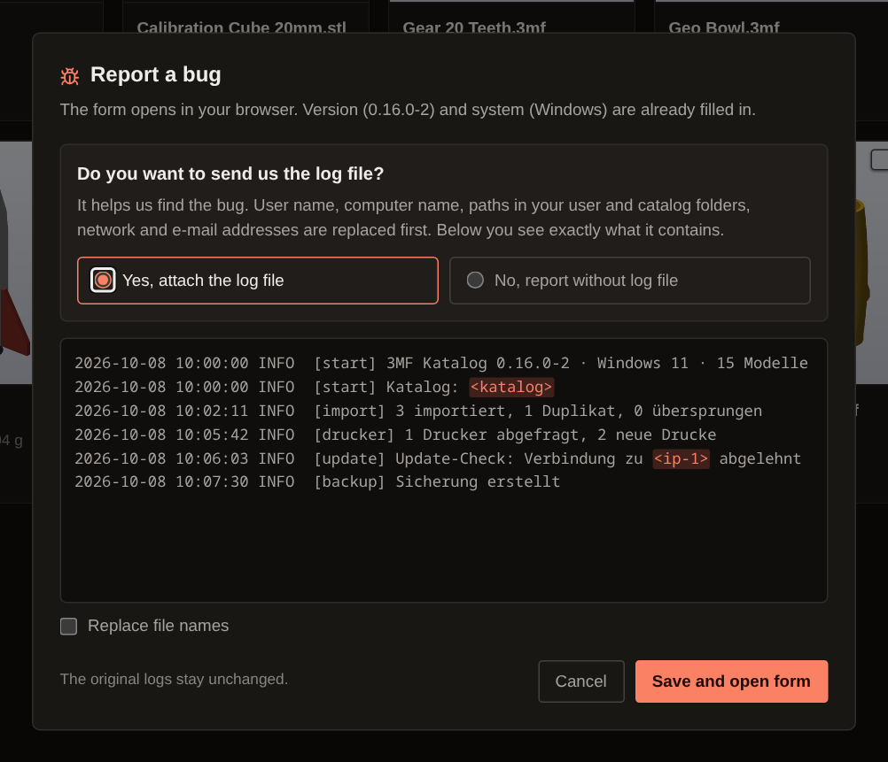

Settings → Info → **Report a bug** (or **Report problem** next to an unexpected error) opens a short dialog. First decide whether to send the log file. With **Yes** you see exactly what will be in it: user name, computer name, home folder and catalog paths, printer and other network addresses, e-mail addresses and — if you tick "Replace file names" — file names are replaced. **Save and open form** puts `3mf-katalog-log-<date>.txt` into your download folder and opens the form on 3mfkatalog.de with version (in the screenshot: 0.16.0) and system filled in; attach the file there under "Log file". The app never sends anything by itself.

**Detailed log:** only needed if we ask for it. It additionally records every action with file names and turns itself off after 7 days. **Open log folder** (under **FOLDERS**, see [Info](#info)) shows the log files.

## Updating

On startup the app checks once in the background whether a newer version is available. The
result shows up in two places with the same content: a dismissible toast in the bottom-right
corner, and the Info tab under Settings (see [Info](#info) above), where "Check for updates
again" repeats the check any time.

**On Windows, macOS, and the Linux AppImage**, when a newer version is found:

1. **"Version X.Y.Z is available"** (in the screenshot: 0.16.1, offered to an installation of
   0.16.0) — "Update now" downloads it; the app checks its
   signature before the update can be installed; "What's new?" opens the release notes on GitHub.

   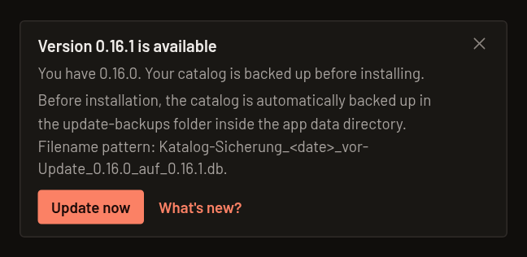

2. **Downloading** — a progress bar shows the download; you can keep working in the app while
   it runs.
3. **"Update X.Y.Z is ready"** — "Restart and install" backs up your catalog database, then
   closes the app, installs the update, and restarts it. On Windows, installation itself just
   shows a small progress bar; you don't need to click anything there.
4. **"Later"** discards the downloaded update without installing it — nothing changes. If you
   decide to update afterwards, click "Update now" again; it downloads the file a second time.
5. If the backup or the install fails, "Update failed" appears with "Nothing was installed;
   your version and your catalog are unchanged." and a "Try again" button. The app never
   installs an update without a successful backup first.

**Package installs on Linux (`.deb`, `.rpm`) and other Linux runs outside an AppImage** can't replace themselves
this way — only the AppImage can. There, the button reads "Go to download page" instead and
opens the release on GitHub, where you install the new version the way you normally would for
your package.

Once an update has installed successfully, the Info tab shows a short note ("Updated on \<date\>
· Backup: \<file\>") until the next update.

**If the check fails** (no internet, or a firewall or antivirus program blocks it), the Info tab
says "Couldn't check for updates. Please check your internet connection or firewall." instead of
"You're on the latest version." Some security programs, for example Kaspersky or TinyWall, block
the request without telling you: allow 3MF Katalog Manager internet access there. The app only
downloads a small file with the current version number. You can also download a new version from
[3mfkatalog.de](https://3mfkatalog.de/) at any time and install it over the old one; your catalog is kept.

### Restoring a backup after an update

Before an in-app update is installed, the app copies the catalog database to `update-backups`
inside its data folder. Settings → Info → "Open data folder" opens the data folder; the copies are in its subfolder `update-backups`:

- Windows: `%APPDATA%\com.thebexxs.mfkatalogmanager\update-backups`
- macOS: `~/Library/Application Support/com.thebexxs.mfkatalogmanager/update-backups`
- Linux: `~/.local/share/com.thebexxs.mfkatalogmanager/update-backups`

Update copies are named `Katalog-Sicherung_<YYYY-MM-DD_HHMM>_vor-Update_<from>_auf_<to>.db`.
The file contains the catalog from before the update; `<from>` is the version you came from,
`<to>` the target version. Before migrating an existing catalog on startup, the app also
attempts a copy named `Katalog-Sicherung_<YYYY-MM-DD_HHMM>_vor-Schema-Migration_<a>_auf_<b>.db`,
where `a` and `b` are schema numbers. This also applies to manual installations. A failed
schema copy is logged and does not prevent startup, so keep a separate export before updating.
If a name already exists, a numbered suffix preserves the earlier copy.

Retention is separate for each kind:

- Normal update copies: the newest three, including legacy update copies.
- Copies made when leaving a stable version: the oldest and newest are always retained by
  automatic cleanup. Intermediate copies in this group can be removed. They do not count
  toward the three normal update copies.
- Schema-migration copies: the newest two, independently of update copies.
- Unrelated files are never deleted by this cleanup. The copy just created is protected.

These automatic `.db` files are database copies, not ZIP catalog exports. "Import catalog"
accepts only ZIP exports and cannot open them. To return using an automatic database copy:

1. In Settings → Info, use "Open data folder" and open `update-backups`. Find the copy made
   before the update you want to undo. Copy it somewhere safe.
2. Export the current catalog under Settings → Catalog → "Export catalog" if the app still
   opens, then close the app completely.
3. Install the previous version from the
   [Releases page](https://github.com/Bexxs75/3mf-katalog-manager/releases), without starting it yet.
4. Keep the current `catalog.db` as a separate safety copy. Copy the selected pre-update
   database into the app data folder (one level above `update-backups`) as `catalog.db`.
5. Start the previous version. The catalog is at the time of that copy; later catalog changes
   are not included.

For a ZIP export, use the import steps below in a version compatible with that backup.
Importing into the newer app does not undo a schema migration. If the older app cannot start
with the current catalog, its import dialog is unavailable; use the database-copy route above.

## Backing up and restoring your catalog

"Catalog backup" in Settings exports your complete catalog (database and settings) as a ZIP
file — handy before switching systems or simply as a safety copy. When restoring such a backup,
the app automatically backs up your existing database first, so an accidental import never
overwrites anything irreversibly.

To restore a ZIP export:

1. Open Settings → Catalog → "Catalog Backup". Use "Export catalog" first if you want to
   retain the current state separately.
2. Choose "Import catalog" and confirm "Yes, replace". This replaces the entire current catalog.
3. Select the ZIP file created with "Export catalog". The app validates it before replacement.
   If it is rejected, the current catalog remains unchanged and an error is shown.
4. After a successful import, the interface reloads with the restored catalog.

## Known limitations

- **"Open in slicer" for manually added slicers on macOS**: automatic slicer detection already
  finds the correct, directly executable program file inside the `.app` bundle for known programs
  (Bambu Studio, OrcaSlicer, PrusaSlicer, SuperSlicer, UltiMaker Cura) — "Open in slicer" works
  reliably for those. If you add a slicer manually instead, you need to navigate the macOS file
  picker to `<Name>.app/Contents/MacOS/<Name>` (⌘⇧G lets you type the path directly), since a
  `.app` bundle itself isn't a directly executable thing in the technical sense.
- The macOS and Windows installer packages are **unsigned** — Gatekeeper and SmartScreen
  respectively will warn on first launch (see [Installation](#installation) for the way around
  it).
- There is **no cloud connection** — the catalog is deliberately local-only; an earlier Google
  Drive integration was removed again because it was too unstable in everyday use.
- The **printer connection** currently supports Klipper/Moonraker only. OctoPrint and Bambu Lab
  are planned, PrusaLink later.

## Frequently asked questions (FAQ)

**Why do some models show only a dotted pattern instead of a preview image?**
The model has neither an uploaded image of its own, nor a thumbnail embedded in the file, nor has
a 3D snapshot been generated for it yet. The app renders missing snapshots in the background one
after another, so with many new files this can take a few minutes. To see it right away, open the
model once, or upload your own image via "Upload image" on the detail page.

**I accidentally deleted a file — is it gone?**
No, as long as fewer than 7 days have passed: it sits in the trash and can be restored from
there.

**How do I get my existing folder structure into the catalog?**
Choose "Use existing folder structure" during initial setup (see
[Getting started](#getting-started)), or later via "Catalog location" in Settings.

**Can I use the same catalog on multiple computers?**
Not automatically/synced — there's currently no cloud connection for that (see
[Known limitations](#known-limitations)). But "Catalog backup" (export/import) lets you transfer
the catalog to another computer manually.

**Can I go back to the old version after an update?**
Only with a compatible backup. New versions can migrate the catalog database, which an older
version may not be able to open. In-app updates create a database copy before installation;
startup also attempts a copy before a schema migration, including after a manual installation.
Create a ZIP export under Settings → Catalog before updating as well. See
[Restoring a backup after an update](#restoring-a-backup-after-an-update) for the difference
between automatic database copies and ZIP imports, and the steps back.

**Why does the "Source" field look a bit odd on some systems when no URL is set?**
That's just placeholder text ("https://…") with a small pencil icon next to it for editing —
the interface uses Barlow and SVG icons. Paths and addresses use IBM Plex Mono.

---

# Benutzerhandbuch — 3MF Katalog Manager

Dieses Handbuch richtet sich an alle, die den 3MF Katalog Manager zum ersten Mal benutzen und
sich mit der App noch nicht auskennen. Es erklärt Schritt für Schritt, wie du Modelle
importierst, organisierst, druckfertig machst und deine Spulen im Material Manager verwaltest.

> **Hinweis zu den Bildern in diesem Handbuch:** Die Screenshots zeigen die App
> mit einem erfundenen
> Demo-Katalog (Modelle wie "Rakete" oder "Spiralvase", erfundene Filamentspulen, Resin-Flaschen
> und Hersteller) — keine echten Nutzerdaten.

## Inhalt

1. [Was ist der 3MF Katalog Manager?](#was-ist-der-3mf-katalog-manager)
2. [Installation](#installation-1)
3. [Erste Schritte](#erste-schritte)
4. [Die Oberfläche im Überblick](#die-oberfläche-im-überblick)
5. [Dateien importieren](#dateien-importieren)
6. [Katalog durchsuchen und organisieren](#katalog-durchsuchen-und-organisieren)
7. [Ein Modell im Detail ansehen](#ein-modell-im-detail-ansehen)
8. [Schnelle Aktionen: Kontextmenü und Mehrfachauswahl](#schnelle-aktionen-kontextmenü-und-mehrfachauswahl)
9. [Sammlungen](#sammlungen)
10. [Werkzeuge in der Seitenleiste](#werkzeuge-in-der-seitenleiste)
11. [Modelle direkt im Slicer öffnen](#modelle-direkt-im-slicer-öffnen)
12. [Der Material Manager](#der-material-manager)
13. [Druckprotokoll](#druckprotokoll)
14. [Der Papierkorb](#der-papierkorb)
15. [Einstellungen](#einstellungen)
16. [Aktualisieren](#aktualisieren)
17. [Katalog sichern und wiederherstellen (Backup)](#katalog-sichern-und-wiederherstellen-backup)
18. [Bekannte Einschränkungen](#bekannte-einschränkungen)
19. [Häufige Fragen (FAQ)](#häufige-fragen-faq)

---

## Was ist der 3MF Katalog Manager?

Der 3MF Katalog Manager ist ein Desktop-Programm, mit dem du eine große Sammlung von
3D-Druck-Dateien (`.3mf`, `.stl`, `.obj` sowie CAD-Quelldateien im `.stp`-/`.step`-Format) übersichtlich verwalten kannst: mit Vorschaubildern,
Ordnern, Tags, Suche, einem eigenen Lager für deine Filamentspulen und einem direkten Weg, ein
Modell mit einem Klick in deinem Slicer-Programm zu öffnen. Ab v0.16.0 ist die STEP-Vorschau in jedem Download enthalten: Open CASCADE erzeugt auch für STEP-Dateien eine 3D-Vorschau
und liest Maße, Volumen und Körperzahl aus. Alles läuft lokal auf deinem Rechner — es gibt keine
Cloud-Anbindung, deine Daten verlassen deinen Computer nicht.

## Installation

Die App steht für Linux, Windows und macOS zum Download bereit (siehe die
[Releases-Seite](https://github.com/Bexxs75/3mf-katalog-manager/releases) des Projekts). Ab v0.16.0 gibt es einen Download je Plattform, immer mit STEP-Vorschau
(`.stp`/`.step`). Er ist größer als das bisherige Standardpaket und hat keinen
`-STEP`-Zusatz. Nutzer des bisherigen Standardpakets erhalten ihn beim nächsten Update in der App.

| Plattform | Download |
|---|---|
| Windows | `3MF-Katalog-Manager-0.16.0-Windows-x64.msi` |
| macOS | `3MF-Katalog-Manager-0.16.0-macOS-universal.dmg` |
| Linux | `3MF-Katalog-Manager-0.16.0-Linux-x86_64.AppImage` |

- **Linux:** die `.AppImage`-Datei herunterladen, ausführbar machen (Rechtsklick → Eigenschaften
  oder `chmod +x`) und starten.
- **Windows:** `.msi`-Installer ausführen. Das Paket ist unsigniert (kein
  Windows-Code-Signing-Zertifikat) — SmartScreen warnt beim ersten Start. Über "Weitere
  Informationen" → "Trotzdem ausführen" fortfahren.
- **macOS:** `.dmg`-Datei öffnen und die App in den Programme-Ordner ziehen. Auch hier ist das
  Paket unsigniert (kein Apple-Developer-Zertifikat) — Gatekeeper blockiert den ersten Start.
  Mit Rechtsklick auf die App → "Öffnen" und im Dialog bestätigen lässt sie sich trotzdem
  starten. Meldet macOS, die App sei „beschädigt und kann nicht geöffnet werden“, zieh sie zuerst
  in den Programme-Ordner und führe dann im Terminal
  `xattr -cr "/Applications/3MF Katalog Manager.app"` aus.

### Deinstallieren

Beim Deinstallieren wird das Programm entfernt, **Katalog, Einstellungen und Logs bleiben aber
absichtlich erhalten** – so geht bei einer Neuinstallation oder einem Update von Hand nichts
verloren. Willst du alles loswerden, lösch danach diese Ordner (solange die App noch installiert
ist, zeigt Einstellungen → Info → „Datenordner öffnen“ / „Log-Ordner öffnen“ sie dir):

- **Windows:** `%APPDATA%\com.thebexxs.mfkatalogmanager` und
  `%LOCALAPPDATA%\com.thebexxs.mfkatalogmanager` (Logs und Zwischenspeicher der Oberfläche)
- **macOS:** `~/Library/Application Support/com.thebexxs.mfkatalogmanager`,
  `~/Library/Logs/com.thebexxs.mfkatalogmanager` und, falls vorhanden,
  `~/Library/Caches/com.thebexxs.mfkatalogmanager` und `~/Library/WebKit/com.thebexxs.mfkatalogmanager`
- **Linux:** `~/.local/share/com.thebexxs.mfkatalogmanager` (Katalog, Einstellungen, Logs) und,
  falls vorhanden, `~/.cache/com.thebexxs.mfkatalogmanager`

Deine Modelldateien selbst werden nie angefasst – sie bleiben in deinem Katalog-Ordner.

## Erste Schritte

Beim allerersten Start fragt dich die App, wie dein Katalog organisiert sein soll:

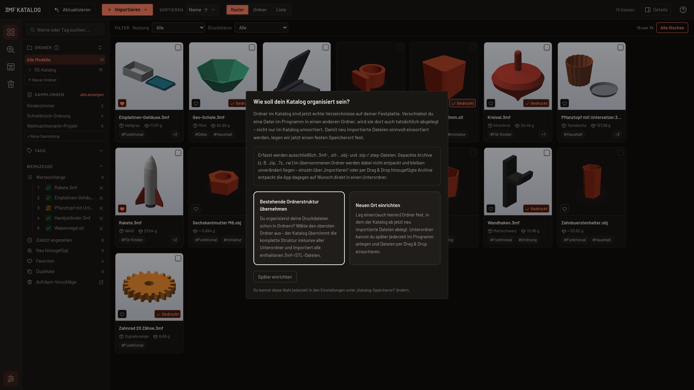

Seit dieser App-Version entsprechen die Ordner im Katalog echten Verzeichnissen auf deiner
Festplatte — verschiebst du eine Datei im Programm in einen anderen Ordner, wird sie dort auch
tatsächlich abgelegt, nicht nur im Katalog umsortiert. Du hast zwei Möglichkeiten:

- **Bestehende Ordnerstruktur übernehmen** — wenn du deine Druckdateien schon in Ordnern
  organisierst, wählst du den obersten Ordner aus. Der Katalog übernimmt die komplette Struktur
  inklusive Unterordner und importiert alle enthaltenen `.3mf`-/`.stl`-/`.obj`-/`.stp`-/`.step`-Dateien automatisch.
- **Neuen Ort einrichten** — ein Ordner, in dem der Katalog ab jetzt neu importierte Dateien
  ablegt. Unter „Wo soll der Katalog-Ordner liegen?“ ist dein Dokumente-Ordner vorgeschlagen;
  „Ort wählen …“ wählt einen anderen. Unter „Name des neuen Ordners“ tippst du den Namen ein
  (Vorschlag: „3D-Katalog“). Die Zeile darunter zeigt den ganzen Pfad, bevor etwas passiert;
  „Ordner anlegen und einrichten“ legt den Ordner an und verwendet ihn. Gibt es dort schon einen
  Ordner mit diesem Namen, sagt die App das und verwendet ihn so, wie er ist; liegt dort stattdessen eine Datei oder eine Verknüpfung mit diesem
  Namen, musst du einen anderen Namen wählen. Namen mit Zeichen,
  die in Ordnernamen nicht erlaubt sind (`/ \ : * ? " < > |`), lehnt sie mit einem Hinweis ab.
  Willst du lieber einen Ordner nehmen, den du schon hast, klickst du auf „einen vorhandenen
  Ordner direkt wählen“.

Du kannst diese Wahl jederzeit in den Einstellungen unter "Katalog-Speicherort" ändern. Über
dem Knopf "Später einrichten" lässt sich der Dialog auch überspringen.

Bereits gepackte Archive (z. B. `.zip`) werden beim automatischen Einlesen nicht berücksichtigt
und bleiben unverändert liegen — entpacke sie bei Bedarf vorher, oder öffne den Ordner nach der
Einrichtung direkt über den Katalog im Dateimanager.

## Die Oberfläche im Überblick

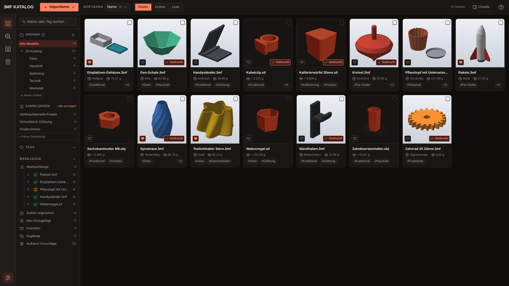

- **Ganz links, die schmale Navigationsleiste:** wechselt zwischen Katalog, Printer Manager, Material Manager und
  Papierkorb (mit Mengen-Badge). Ganz unten befindet sich das Zahnrad-Symbol für die
  Einstellungen.
- **Seitenleiste (Sidebar):** Suchfeld, darunter dein Ordnerbaum mit Anzahl der Modelle pro
  Ordner, deine Sammlungen, deine Tags und deine Druck-Warteschlange.
- **Hauptbereich:** dein Katalog als Raster (Kacheln mit Vorschaubild) oder als Liste
  umschaltbar, dazu Sortierung und der "Importieren"-Button oben links.
- **Kopfzeile:** nennt den aktuellen Manager-Bereich.
- **Detailbereich rechts:** öffnet sich beim Anklicken eines Modells. Unter Einstellungen →
  Allgemein → "Detailbereich" wählst du "Automatisch (erscheint beim Anklicken)" oder "Immer sichtbar".
  Er zeigt Vorschau, Metadaten und Druckstatus. Je nach vorhandenen Daten zeigen Status-Badges
  außerdem Material, Filament-Prüfung, Favorit, Warteschlange und den zuletzt verwendeten Drucker.

## Dateien importieren

Über den roten "+ Importieren"-Button oben links stehen mehrere Wege offen: einzelne Dateien per
Dialog auswählen, einen ganzen Ordner (inklusive Unterordner) importieren, nur den Inhalt eines
Ordners in deinen Katalogordner übernehmen („Ordnerinhalt…“, siehe
[Ordnerinhalt importieren](#ordnerinhalt-importieren)), oder Dateien direkt per
Drag & Drop aus deinem Dateimanager in das Katalog-Fenster ziehen. Beim Import werden Abmessungen,
Volumen, Objektanzahl und (falls in der Datei vorhanden) Materialangaben automatisch ausgelesen,
und die App schlägt passende Hashtags vor, die du danach frei bearbeiten kannst. Automatisch
vergebene Tags wie „mehrteilig“, „miniatur“, „grossformat“ und „mehrfarbig“ erscheinen in der
eingestellten Sprache der Oberfläche; die Suche findet sie unter beiden Namen.

Importiert die App eine Datei, die inhaltlich bereits im Katalog vorhanden ist (exakter
Duplikat-Abgleich per Inhalts-Hash), wird das erkannt, statt sie ein zweites Mal anzulegen.

Das Import-Menü listet „Dateien...“, „Ordner...“ und „Ordnerinhalt…“. Ein Hinweisfeld oben im Menü
erklärt, wo die Dateien landen, sobald du auf einen Eintrag zeigst: Im Dateidialog ausgewählte
Dateien kommen in den aktiven Katalogordner oder den eingerichteten Katalog-Speicherort. Ohne
Speicherort bleiben sie an ihrem Ort. Beim Ordner-Import und beim Ziehen von Dateien von außen
bleiben sie ebenfalls am bisherigen Ort. Das Ziel wird beim Start des Imports festgehalten – ein
Ordnerwechsel danach ändert nichts mehr.

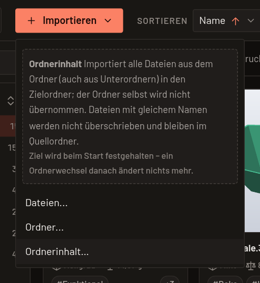

Die Fortschrittszeile zeigt den aktuellen Schritt und bietet "Abbrechen". Bereits importierte
Dateien bleiben im Katalog. Weitere Importe warten in einer Warteschlange. Während der Suche
siehst du die Anzahl der bisher gefundenen Dateien. Öffne nach Abschluss "Details": Dort stehen
nicht importierte Dateien mit Gründen sowie importierte Dateien, die nicht abgelegt werden konnten.
"Liste kopieren" kopiert die Ergebnisliste.

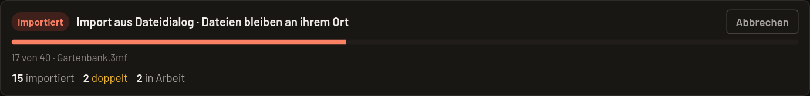

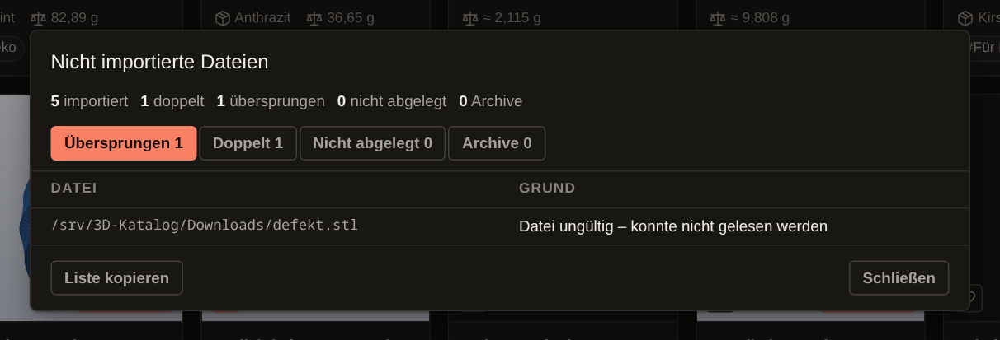

Zum Verschieben ziehst du ein Katalogmodell am Griff seiner Karte auf einen Ordner. Eine Vorschau
folgt dem Mauszeiger, passende Ziele werden hervorgehoben. Zugeklappte Ordner mit Unterordnern
öffnen sich beim Drüberhalten. Ziehst du ein Modell auf eine Sammlung, wird es ihr hinzugefügt.

### Ordnerinhalt importieren

„Importieren → Ordnerinhalt…“ übernimmt alle unterstützten Dateien eines gewählten Ordners, auch
die aus seinen Unterordnern, direkt in den aktuellen Zielordner – den aktiven Katalogordner bzw.
den Katalog-Speicherort, wenn „Alle“ gewählt ist. Anders als bei „Ordner...“ wird die Struktur des
Quellordners im Katalog nicht nachgebaut, und der Quellordner selbst wird nicht übernommen. Die
Dateien werden wie bei „Dateien...“ in den Zielordner verschoben (wenn ein Katalog-Speicherort
eingerichtet ist). Dateien mit gleichem Namen werden nicht überschrieben und bleiben im Quellordner.
Leere Quellordner bleiben auf der Festplatte erhalten. Die Fortschrittszeile nennt diesen Import
„Ordnerinhalt“.

### Archive entpacken

Importierst oder ziehst du ein einzelnes Archiv (`.zip`, `.7z`, `.rar`, `.tar`, `.tar.gz`/`.tgz`,
`.tar.bz2`, `.tar.xz`, `.tar.zst`) statt einzelner Modell-Dateien, öffnet sich vor dem eigentlichen
Import ein Dialog:

- **Zielordner** — vorbelegt mit dem aktiven Katalogordner bzw. deinem Speicherort, über
  „Ändern…" änderbar. Jedes Archiv bekommt darin einen eigenen Unterordner. Als Ziel möglich sind
  nur Katalogordner oder ein in einem Ordner-Auswahldialog der App (z. B. über „Ändern…") gewählter
  Ordner; Ordner, die geschützte Bereiche
  enthalten — etwa dein Home-Verzeichnis selbst —, lehnt die App als Ziel ab (wähle dann einen
  Unterordner, z. B. `~/3D-Drucke`).
- **Konflikt, wenn der Unterordner schon existiert** — du wählst zwischen „Neuen Ordner mit
  Nummer anlegen" und „Zusammenführen" (vorhandene Dateien bleiben dabei unverändert, übersprungene
  werden im Ergebnis gezählt).
- **Checkbox „Archive nach dem Entpacken löschen"** — standardmäßig aus. Ist sie aktiv, wird das
  Original-Archiv nur gelöscht, wenn wirklich alles entpackt wurde. Wurde etwas nicht entpackt
  (gesperrte Dateitypen, unsichere Einträge oder beim Zusammenführen bereits vorhandene Dateien),
  bleibt das Archiv liegen — das Ergebnis-Banner nennt den Grund.
- **Ausgegraute Zeilen** — Archive, die keine Modelle enthalten, beschädigt, verschlüsselt oder in
  einem nicht unterstützten Format sind, werden in der Liste grau dargestellt und beim Entpacken
  automatisch übersprungen.

Schlägt bereits die Prüfung des Archivs fehl (z. B. weil es zwischenzeitlich verändert oder
gelöscht wurde), öffnet sich kein Dialog — stattdessen zeigt das Ergebnis-Banner
„<Name> fehlgeschlagen: <Fehler>" an, bis du es wegklickst.

Aus Sicherheitsgründen werden Programme, Skripte und Verknüpfungen aus Archiven nie entpackt;
passwortgeschützte und mehrteilige Archive werden erkannt, aber nicht entpackt. Enthält ein RAR-Archiv
eine einzelne Datei über 1 GB, schlägt das ganze Archiv fehl (bereits Entpacktes wird wieder
entfernt). Datei-Verweise in RAR-Archiven (mit `rar -oi` erzeugt) werden nicht aufgelöst: Sie
werden übersprungen, als leere Datei angelegt oder lassen bei einem Prüfsummenfehler das ganze
Archiv scheitern. Der Ordner-Import entpackt weiterhin keine
enthaltenen Archive.

Enthält ein Archiv auch Dateien, die keine Modelle sind (z. B. TXT oder PDF), werden sie ebenfalls
entpackt. Der Ergebnishinweis und der Reiter „Archive“ unter „Details“ nennen dann, wie viele
weitere Dateien entpackt, aber nicht in den Katalog aufgenommen wurden (der Katalog zeigt nur
Modelle) und dass sie im Zielordner liegen.

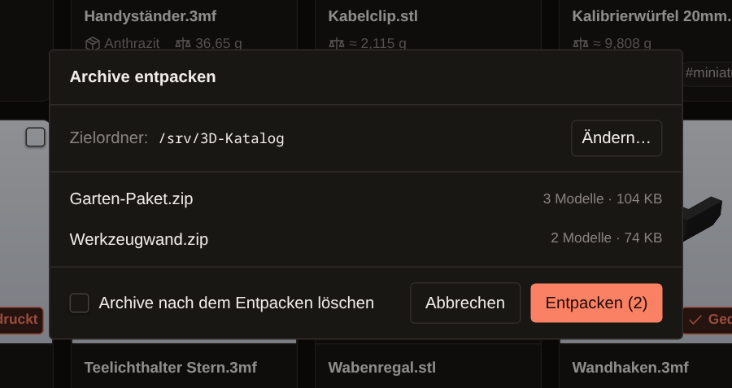

## Katalog durchsuchen und organisieren

Oben rechts neben "Importieren" wechselst du zwischen drei Ansichten: **Raster** (Bildkacheln,
siehe Screenshot oben), **Ordner** und **Liste**:

Die Liste zeigt zusätzliche Spalten (Tags, Volumen, Dateigröße) und lässt sich per Klick auf die
Spaltenüberschrift sortieren.

Die Filterleiste über den Modellen zeigt aktive Ordner-, Tag-, Sammlungs- und Suchfilter sowie
die gewählte Werkzeugansicht, Nutzung und Druckstatus. Über die Schließen-Knöpfe entfernst du
Filter einzeln. "Filter zurücksetzen" setzt sie gemeinsam zurück (es werden keine Modelle gelöscht).

In derselben Leiste stehen zwei Auswahlfelder: **Nutzung** („Alle“, „Kommerziell erlaubt“, „Nur
privat“, „Nicht angegeben“ – abgeleitet aus der [Lizenz](#lizenz-und-nutzung) des Modells) und
**Druckstatus** („Alle“, „Gedruckt“, „Noch nicht gedruckt“). Beide lassen sich miteinander und mit
Ordner, Tag, Suche und den übrigen Filtern kombinieren; eine aktive Auswahl erscheint zusätzlich
als Chip, den du entfernen kannst.

Unter "Sortieren" wählst du "Name", "Importdatum", "Änderungsdatum", "Dateigröße", "Volumen",
"Druckstatus" oder "Zuletzt angesehen". Alle lassen sich in beide Richtungen sortieren: etwa
"Älteste zuerst" oder "Neueste zuerst" für Datumswerte, "A → Z" oder "Z → A" für Namen und
"Noch nicht gedruckte zuerst" oder "Gedruckte zuerst" für den Druckstatus. Innerhalb jeder
Druckstatus-Gruppe sind die Modelle nach Name geordnet.

"Tags filtern …" durchsucht die Tag-Liste der Seitenleiste. Der Knopf unter der Liste blendet
auch Tags mit nur einem Modell ein. Beim Hinzufügen von Tags in den
Modelldetails erscheinen vorhandene Tags als Vorschläge. Farbpunkte kennzeichnen die Tags in
Seitenleiste, Detailbereich und Detailseite. Zieh den Rand der Seitenleiste, um ihre Breite zu
ändern. "Alle Ordner zuklappen" klappt den Baum ein. Symbole unterscheiden Ordner, Sammlungen und Tags.

### Ordner-Ansicht

Die Ansicht **Ordner** gruppiert deine Modelle nach der echten Ordnerstruktur auf der Festplatte —
wie in einem Datei-Explorer, mit Unterordnern eingerückt und einer durchgehenden Verbindungslinie:

Jede Ordner-Kopfzeile zeigt die Gesamtzahl der enthaltenen Dateien, inklusive aller Unterordner.
Per Klick auf die Kopfzeile klappst du einen Ordner ein oder aus — der Zustand bleibt über einen
Neustart der App erhalten. Dateien ohne Ordner erscheinen als letzte Sektion "Ohne Ordner". Sowohl
Ordner-Kopfzeilen als auch einzelne Dateien lassen sich innerhalb dieser Ansicht direkt per Maus
verschieben, genau wie in der Seitenleiste — das Verschieben wirkt sich sofort auch auf der
Festplatte aus.

Dieselbe Gruppierung funktioniert auch in der Listen-Darstellung:

Zum Organisieren stehen dir insgesamt drei unabhängige Mechanismen zur Verfügung, die du beliebig
kombinieren kannst:

- **Ordner** (Sidebar links) — echte Verzeichnisse auf der Festplatte, siehe oben.
- **Tags** — frei vergebene Hashtags, in der Sidebar unter "Tags" gesammelt, anklickbar zum
  Filtern.
- **Sammlungen** — mehrere Modelle explizit zu einem Projekt zusammenfassen (siehe unten,
  [Sammlungen](#sammlungen)).

Über das Suchfeld oben in der Sidebar filterst du nach Name, Tag, Ersteller oder Dateipfad — ein
Treffer in irgendeinem dieser Felder reicht. Mit `/` springst du außerhalb von Textfeldern in die Suche, wenn Einzeltasten-Kürzel eingeschaltet sind.

**Tastaturkürzel:** `/` fokussiert die Suche, die Pfeiltasten navigieren räumlich im Raster (Hoch/
Runter springt anhand der tatsächlich sichtbaren Kachel-Position zur nächsten Zeile, Links/Rechts
zum nächsten/vorherigen Modell), die Leertaste schaltet die Mehrfachauswahl-Checkbox des gerade
ausgewählten Modells um, und Entf/Rücktaste öffnet bei aktiver Mehrfachauswahl die
Löschen-Bestätigung (siehe [Mehrfachauswahl](#schnelle-aktionen-kontextmenü-und-mehrfachauswahl)).
Keines davon greift, solange du gerade in einem Textfeld tippst.

Beim Navigieren mit Tab ist der Tastaturfokus sichtbar. Strg+A (Cmd+A unter macOS) wählt alle
sichtbaren Modelle aus. Escape hebt die Auswahl auf oder schließt ein Menü oder einen Dialog.
Im Suchfeld verlässt Escape das Feld, ohne den Suchtext zu löschen. "Tastenkürzel und Tipps"
öffnest du mit `?`, dem Hilfesymbol in der Kopfzeile oder unter Einstellungen → Info.
Einstellungen → Allgemein → "Einzeltasten-Kürzel" schaltet Kürzel wie `/` und `?` ab.
Strg/Cmd-Kürzel bleiben verfügbar.

### Mit der Festplatte abgleichen

Legst du Dateien in deinen Katalogordnern außerhalb der App an, verschiebst oder löschst du sie
(z. B. im Dateimanager), bringt **Aktualisieren** den Katalog auf den neuesten Stand. Der Knopf
steht in der Kopfzeile neben „Importieren“ und nur in der Katalogansicht; **F5** macht dasselbe,
solange kein Dialog offen ist. Wenn du auf den Knopf zeigst, siehst du, wann zuletzt abgeglichen
wurde („Noch nie“, falls noch nicht). Während ein Import läuft, ist er deaktiviert.

Aktualisieren schaut zuerst nur nach – erst nach deiner Bestätigung ändert sich etwas:

- **Alles stimmt überein:** Unten im Fenster erscheint kurz der Hinweis „Alles aktuell“.
- **Sonst** öffnet sich der Dialog „Abgleich mit der Festplatte“. Er zählt „neue Dateien“, „neue
  Ordner“ und „fehlende Dateien“ und listet sie unter „Neu auf der Festplatte“ und „Auf der
  Festplatte nicht mehr vorhanden“ auf (der Pfad innerhalb des Katalogordners, darunter der
  Katalogordner). Neue Ordner erscheinen nur, wenn sie neue unterstützte Dateien enthalten; leere
  Ordner bleiben außen vor. „Änderungen übernehmen“ legt die neuen Dateien und Ordner im Katalog
  an, „Später“ schließt den Dialog, ohne etwas zu ändern.
- **Fehlende Dateien bleiben standardmäßig erhalten.** Ihre Einträge bleiben im Katalog und
  tauchen weiterhin in der Katalogprüfung auf (Einstellungen → Katalog). Zum Entfernen setzt du
  den Haken bei „Fehlende Dateien aus dem Katalog entfernen“; der Knopf heißt dann „Änderungen
  übernehmen“ (mit neuen Dateien) oder „Entfernen“ (nur fehlende Dateien). Entfernte Einträge
  landen im [Papierkorb](#der-papierkorb) und lassen sich dort wiederherstellen; Notizen, Tags und
  Verbrauch gehen verloren, sobald sie von dort endgültig gelöscht werden.
- **Nichts zu übernehmen:** Gibt es weder neue Dateien noch neue Ordner und hast du die
  Entfernen-Option nicht angehakt, bietet der Dialog nur „Schließen“.
- **Nicht lesbare Ordner** werden mit ihren Pfaden aufgelistet („N Ordner konnten nicht gelesen
  werden“); der Rest wird trotzdem abgeglichen. **Nicht lesbare Dateien** werden übersprungen und
  nach dem Übernehmen mit Pfad angezeigt („N Dateien konnten nicht gelesen werden“); alle lesbaren
  Dateien werden trotzdem importiert.
- **Nicht erreichbarer Katalogordner** (z. B. ein nicht verbundenes Netzlaufwerk oder USB-Laufwerk
  oder ein leerer bzw. nicht eingebundener Ordner): Der Abgleich bricht mit „Ein Katalog-Ordner
  ist nicht erreichbar. Bitte die Verbindung prüfen. Entferne den Ordner aus dem Katalog oder
  verbinde ihn neu.“ und dem Pfad ab, und der Katalog bleibt unverändert. Dateien auf einem solchen
  Ordner gelten nie als fehlend. „Erneut versuchen“ wiederholt die Prüfung. Weitere Meldungen: „Der
  Katalog hat sich geändert. Bitte erneut abgleichen.“ (zwischen Vorschau und Übernehmen hat sich
  etwas geändert), „Ein Pfad hat sich geändert. Bitte erneut abgleichen.“, „Eine Datei konnte nicht
  eingelesen werden. Der Katalog bleibt unverändert.“ und „Der Abgleich ist fehlgeschlagen. Bitte
  erneut versuchen.“
- **Nach dem Übernehmen** fasst ein Hinweis „N neue Dateien · N neue Ordner · N Dateien entfernt“
  zusammen, und die neuen Einträge werden kurz hervorgehoben.

## Ein Modell im Detail ansehen

Ein Doppelklick auf ein Modell öffnet die volle Detailseite:

Oben rechts im Vorschaubereich schaltest du zwischen **3D-Ansicht** (freies Drehen per
Maus-Ziehen, plus Auto-Rotation und 15°-Schritt-Buttons) und dem hinterlegten **Bild** um — welche
der beiden standardmäßig angezeigt wird, legst du in den Einstellungen unter "Bevorzugte Ansicht"
fest. Rechts siehst du alle Metadaten (Maße, Volumen, geschätztes Gewicht, Material, Dateigröße,
Importdatum, Ersteller), darunter ein Feld für eine **Quelle** (z. B. ein Link zur
Modell-Herkunftsseite) sowie deine Hashtags mit Möglichkeit, weitere hinzuzufügen oder zu
entfernen. Wurde die Datei bereits in OrcaSlicer oder Bambu Studio gesliced, liest die App das
reale Filamentgewicht direkt aus den Slicer-Metadaten statt es nur grob zu schätzen — inklusive
Aufschlüsselung pro Druckplatte und Filament sowie einer geschätzten Materialkosten-Summe, wenn
passende Spulen im Material Manager hinterlegt sind. Über den "Metadaten neu einlesen"-Knopf holst du
diese Werte nachträglich nach, falls du eine bereits katalogisierte Datei erst später im Slicer
nachgesliced hast.

Unten links kannst du das Modell als **gedruckt** markieren und es zur **Warteschlange**
hinzufügen. Mit dem **Herz** markierst du es als Favorit; alle Favoriten findest du unter
„Werkzeuge → Favoriten“.

Mit "Vorheriges Modell" und "Nächstes Modell" oder den Pfeiltasten Links/Rechts außerhalb von
Eingabefeldern wechselst du durch die aktuelle Modellreihenfolge. Neben den Knöpfen steht die
Position. Bei laufenden Eingaben wählst du vor dem Wechsel "Weiter bearbeiten" oder
"Verwerfen und wechseln".

Die 3D-Vorschau bietet bei vorhandenen Farbdaten "Dateifarben" oder "Einfarbig".
Farbdaten sind Standard-3MF-Materialien oder, bei Projekten aus Bambu Studio und OrcaSlicer, das
Filament jedes Teils und bemalte Flächen; ein unterteiltes bemaltes Dreieck zeigt seine
überwiegende Farbe. Hat eine Datei Farben, die die Vorschau nicht darstellen kann, sagt die
3D-Ansicht das in einem kurzen Hinweis.
Die Legende erklärt die Dateifarben. Bei 3MF-Dateien mit mehreren Druckplatten aus Bambu Studio,
OrcaSlicer oder Creality Print lautet die Plattenleiste unter der Vorschau „Alle“, Pfeil zurück,
Plattennummern, Pfeil vor. Zeigst du auf eine Nummer, erscheinen „Platte n“ und der Name der
Platte. Die gewählte Platte wird eingepasst und die Legende zeigt nur ihre Farben; solange die
Leiste den Fokus hat, blättern die Pfeiltasten Links/Rechts durch die Platten, und bei der
ersten oder letzten Platte wird der Pfeil grau. Bei mehr als 12 Platten ersetzt ein Zähler wie
„3 / 14“ mit dem Plattennamen die Nummern.

"Im Dateimanager anzeigen" zeigt die Datei von der Detailseite, dem Detailbereich oder dem
Karten-Kontextmenü aus an. Unter macOS heißt die Aktion "Im Finder anzeigen", unter Windows
"Im Explorer anzeigen".

Kann die 3D-Vorschau nicht angezeigt werden, erklärt eine Karte im Vorschaubereich den Grund,
statt ihn leer zu lassen (das hinterlegte Bild bleibt dahinter sichtbar, falls es eines gibt):

- **„Die Datei wurde nicht gefunden“** — prüfe den Speicherort oder entferne den Eintrag aus dem
  Katalog. Die Karte zeigt den Pfad und bietet „Im Dateimanager öffnen“ und „Aus dem Katalog
  entfernen“.
- **„Die Datei lässt sich nicht lesen“** — sie ist beschädigt, gesperrt oder enthält keine
  darstellbare Geometrie; prüfe, ob ein anderes Programm sie geöffnet hat. Die Karte bietet „Im
  Slicer öffnen“.
- **„Das Modell ist für die 3D-Ansicht zu groß“** — es überschreitet die Grenzen der App (zum
  Beispiel binäre STL-Dateien mit mehr als 3 Millionen Dreiecken, ASCII-STL über 256 MiB, OBJ
  über 128 MiB oder 3MF-Modelle mit mehr als 3 Millionen Dreiecken). Nutze das Vorschaubild oder
  öffne es im Slicer.
- **„Die 3D-Ansicht wird auf diesem Rechner nicht unterstützt“** — WebGL ist nicht verfügbar. Nutze
  das Vorschaubild oder öffne die Datei im Slicer.
- Ein Dateityp ohne 3D-Vorschau zeigt „Dieser Dateityp unterstützt keine 3D-Vorschau“. Bei
  unerwarteten Fehlern bietet die Karte zusätzlich „Problem melden“.

### Lizenz und Nutzung

Jedes Modell kann eine **Lizenz** tragen. Im Detailbereich und auf der Detailseite hat der
Abschnitt „Lizenz“ ein Auswahlfeld. Zur Wahl stehen „Nicht gesetzt“, die Creative-Commons-Vorgaben
(CC BY, CC BY-SA, CC BY-NC, CC BY-NC-SA, CC BY-ND, CC BY-NC-ND, CC0), „Nur private Nutzung“,
„Kommerzielle Nutzung erlaubt / Lizenz erworben“, „Eigene Konstruktion“ und „Andere…“. „Andere…“
öffnet ein freies Textfeld „Lizenztext“ (bis 200 Zeichen). „Lizenz speichern“ speichert sie; auf
der Detailseite zählt eine geänderte, nicht gespeicherte Lizenz als ungespeicherte Änderung und
fragt nach, bevor „Nächstes Modell“ sie verwirft.

Aus der Lizenz leitet die App ein **Nutzungs**-Badge ab: „Kommerziell erlaubt“ (CC BY, CC BY-SA,
CC BY-ND, CC0, „Kommerzielle Nutzung erlaubt / Lizenz erworben“ und „Eigene Konstruktion“), „Nur
privat“ (CC BY-NC, CC BY-NC-SA, CC BY-NC-ND und „Nur private Nutzung“) oder „Nicht angegeben“
(nichts gesetzt oder ein freier Text). Das Badge erscheint auf Rasterkacheln und Listenzeilen –
nicht bei „Nicht angegeben“ – und, einschließlich „Nicht angegeben“, neben dem Lizenzfeld. Mit dem
Filter **Nutzung** grenzt du den Katalog ein (siehe
[Katalog durchsuchen und organisieren](#katalog-durchsuchen-und-organisieren)).

Um die Lizenz mehrerer Modelle auf einmal zu setzen, wählst du sie aus und nutzt „Lizenz setzen“
in der Aktionsleiste der Mehrfachauswahl (siehe
[Schnelle Aktionen](#schnelle-aktionen-kontextmenü-und-mehrfachauswahl)). Es öffnet dasselbe
Auswahlfeld und übernimmt die Wahl für alle ausgewählten Modelle. Vorhandene Tags bleiben
unverändert.

## Schnelle Aktionen: Kontextmenü und Mehrfachauswahl

Rechtsklick auf ein Modell öffnet ein Kontextmenü mit den wichtigsten Aktionen:

Über "Umbenennen" änderst du den Dateinamen direkt im Kontextmenü — die Dateiendung wird dabei
fest angezeigt und lässt sich nicht mit wegtippen. Verschiebt der neue Name das Modell
in der Standardsortierung (nach Name) aus dem sichtbaren Bereich, scrollt die Ansicht automatisch
dorthin.

Willst du mehrere Modelle gleichzeitig bearbeiten, markierst du sie über die Checkboxen oben
links auf jeder Kachel (oder "Alle auswählen"). Eine Aktionsleiste erscheint, über die sich die
Auswahl gemeinsam zur Warteschlange oder einer Sammlung hinzufügen, mit einem Tag versehen oder
davon befreien ("Tag hinzufügen" / "Tag entfernen" — Letzteres zeigt ein Dropdown mit allen in
der Auswahl vorkommenden Tags), als gedruckt/nicht gedruckt markieren oder löschen lässt. Bei
aktiver Mehrfachauswahl öffnet auch die Taste Entf/Rücktaste direkt die Löschen-Bestätigung:

### Aus dem Katalog entfernen

Mit **Aus dem Katalog entfernen** im Modell-Kontextmenü oder **Aus Katalog entfernen** in der
Auswahlleiste entfernst du Katalogeinträge. Die Bestätigung nennt das Modell oder die Anzahl der
ausgewählten Modelle. Bestätige mit **Entfernen**. Die Dateien auf der Festplatte bleiben
unverändert; die Modelle werden nicht in den Papierkorb verschoben.

Klicke mit der rechten Maustaste auf einen Ordner und wähle **Aus dem Katalog entfernen**, um ihn
und seinen Katalog-Unterbaum zu entfernen. Die Bestätigung zeigt den Ordnernamen, die Anzahl der
Unterordner (ohne den gewählten Ordner) und die Anzahl der Modelle im gesamten Unterbaum (ohne
Papierkorb-Einträge). Dabei verschwinden auch deren Tag-Zuordnungen und Einträge im Druckprotokoll.
Ordner und Dateien auf der Festplatte bleiben unverändert und können später wieder importiert
werden. Vorhandene Papierkorb-Einträge bleiben erhalten.

Der Katalog-Speicherort und seine übergeordneten Ordner im Katalog lassen sich nicht entfernen.
Die Meldung lautet:

> Das ist der Speicherort des Katalogs. Zum Leeren „Katalog zurücksetzen“ in den Einstellungen verwenden.

## Sammlungen

Sammlungen sind ein dritter Organisationsmechanismus neben Ordnern und Tags: Du fasst mehrere
Modelle explizit zu einem Projekt zusammen, mit einer manuell festlegbaren Reihenfolge (Drag &
Drop). Eine neue Sammlung legst du über "+ Neue Sammlung" in der Sidebar an und befüllst sie über
die Mehrfachauswahl. Ein Klick auf eine Sammlung in der Sidebar filtert den Katalog auf ihre
Modelle:

Per Rechtsklick auf eine Sammlung in der Seitenleiste erreichst du "Umbenennen" und "Löschen".
Zieh Modelle auf eine Sammlung, um sie hinzuzufügen. Der Zurück-Knopf verlässt die Sammlungsgalerie.

## Werkzeuge in der Seitenleiste

Unten in der Seitenleiste bündelt der Bereich **Werkzeuge** mehrere Hilfen, jeweils mit Anzahl.
Über die Überschrift lässt er sich zuklappen.

- **Warteschlange** — Modelle, die als Nächstes gedruckt werden sollen. Aufklappbar und per
  Drag & Drop sortierbar; ein Klick auf einen Eintrag zeigt das Modell an. Ein Symbol je Eintrag
  zeigt, ob dein Filament reicht (siehe [Reicht das Filament?](#reicht-das-filament)). Markierst
  du ein Modell als gedruckt, verschwindet es automatisch aus der Warteschlange.
- **Zuletzt angesehen** — die 20 zuletzt geöffneten Modelle, das neueste zuerst.
- **Neu hinzugefügt** — alles, was in den letzten 7 Tagen importiert wurde.
- **Favoriten** — alle Modelle, die du mit dem Herz markiert hast, alphabetisch sortiert.
- **Duplikate** — Modelle mit identischem Dateiinhalt, als Gruppen nebeneinander.
- **Aufräum-Vorschläge** — prüft den Katalog auf fehlende Dateien und Duplikate.

Eine gewählte Ansicht erscheint oben als Filter-Chip und lässt sich mit Ordnern, Tags und Suche
kombinieren. Ein zweiter Klick auf die Ansicht oder das ✕ am Chip hebt sie wieder auf.
Printer Manager, Material Manager und Papierkorb erreichst du über die Symbole in der linken Leiste.

## Modelle direkt im Slicer öffnen

Über "In Slicer öffnen" (im Detailpanel, auf der Detailseite oder im Kontextmenü) startet die App
direkt dein Slicer-Programm mit der ausgewählten Datei. Welche Slicer zur Auswahl stehen und
welcher davon dein **Standard-Slicer** ist, richtest du in den Einstellungen ein (siehe unten).

> Unter macOS funktioniert das für automatisch erkannte Slicer zuverlässig. Fügst du
> stattdessen einen Slicer manuell hinzu, musst du im Auswahldialog gezielt die Programmdatei
> **innerhalb** des `.app`-Bundles auswählen (nicht das Bundle selbst) — siehe
> [Bekannte Einschränkungen](#bekannte-einschränkungen).

## Der Material Manager

Der Material Manager ist eine eigenständige Verwaltung für deine Filamentspulen, unabhängig vom
Modell-Katalog. Du erreichst ihn über das zweite Symbol in der Navigationsleiste ganz links.

Oben siehst du eine Statistik-Leiste (Spulen gesamt, Restbestand gesamt, belegte Lagerplätze,
Spulen mit niedrigem/leerem Bestand). Jede Spulen-Karte zeigt Material, Hersteller, Farbe,
Lagerort, verbleibendes Gewicht als Balken und Prozentwert sowie einen Status: **Vorrätig**
(grün), **Niedrig** (orange, wenn der Bestand knapp wird) oder **Leer**. Über die
Filterknöpfe "Niedrig"/"Leer" oder das Suchfeld findest du gezielt Spulen, die bald nachbestellt
werden müssen.

Alternativ zur Kachel-Ansicht gibt es eine sortierbare Listenansicht ("Liste" neben "Dashboard"):

Über "+ Spule anlegen" öffnest du das Formular für eine neue Spule:

Neben den üblichen Angaben (Material, Hersteller, Farbe, Lagerort, Durchmesser, Preis,
Ursprungs-/Restgewicht, optional ein Foto) lässt sich hier auch die **Anzahl** angeben: Legst du
z. B. drei identische PLA-Spulen gleichzeitig an, erhält jede davon trotzdem ihren eigenen,
unabhängig verfolgten Restbestand. Gewichte speichert die App auf 0,1 g genau. Für Material,
Hersteller und Lagerort schlägt die App beim Tippen bereits verwendete Werte vor (Autocomplete).
Das Foto wählst du per Klick auf das Bildfeld aus oder ziehst es direkt aus dem Dateimanager
darauf (eine PNG-, JPG- oder WebP-Datei, höchstens 5 MB). Passt ein Bild nicht, steht der Hinweis
direkt unter dem Bildfeld und das Formular bleibt beim Speichern offen: Wähl ein anderes Bild oder
schließ den Hinweis mit ✕, um ohne dieses Bild zu speichern.

**Bearbeiten per Doppelklick:** Ein Doppelklick auf eine Karte oder eine Zeile der Liste öffnet
dasselbe Formular wie der Stift ✎.

**Nachkaufen:** Hast du eine Spule nachgekauft, die du schon im Lager hast, klick auf ihrer Karte
auf „＋ Nachkaufen" (in der Liste auf „＋" in der Zeile). Im kleinen Fenster wählst du die Anzahl
(1 bis 20) und passt bei Bedarf Menge, Preis und Lagerort an. Vorbelegt sind die Werte der
Vorlage, beim Lagerort ihr Stammplatz, falls sie gerade im Drucker steckt. Die neuen Einträge
übernehmen Art, Material, Hersteller, Farbe, Farbwert, Bild und Durchmesser, sind voll und liegen
im Lager. Danach sind sie kurz grün umrandet. Escape oder ein Klick neben das Fenster schließt es,
ohne etwas anzulegen.

**Resin:** Mit „Filament | Resin" oben im Lager wechselst du zu deinen Resin-Flaschen; die App
merkt sich die Auswahl. Übersicht, Liste, Suche und Kennzahlen zeigen dann nur Resin, Mengen in
Milliliter („Flaschen gesamt"). „Flasche anlegen" legt dort immer eine Resin-Flasche an, im
Filament-Bereich entsteht immer eine Spule. Statt des Gewichts gibst du den „Inhalt (ml)" an, einen
Durchmesser gibt es nicht, und Material und Hersteller schlagen Resin-Werte vor. Hast du Resin verbraucht,
klick auf der Flasche auf „− Verbrauch" und trag die Milliliter ein (auf 0,1 ml genau); der Rest
sinkt nie unter 0. Resin-Flaschen kommen nie in ein Filament-Fach, sondern nur in die Harzwanne
eines Resin-Druckers (siehe [Resin-Drucker](#resin-drucker)), und zählen nicht bei „Reicht das
Filament?" und den Materialkosten.

### Reicht das Filament?

Für 3MF-Dateien, die in Bambu Studio oder OrcaSlicer gesliced wurden, vergleicht die Detailseite
den Filamentbedarf (über alle Druckplatten zusammengezählt) mit deinen Spulen: gleiches Material
und ähnliche Farbe. Pro Filament siehst du einen Status:

- **reicht** — eine passende Spule hat genug Restgewicht,
- **reicht mit Spulenwechsel** — es reicht nur, wenn du unterwegs eine zweite Spule einlegst,
- **reicht nicht** — mit der fehlenden Menge,
- **unklar** — keine passende Spule gefunden oder keine Slicer-Daten.

Dazu nennt die App die passende Spule mit Restgewicht und sagt, ob sie im Drucker steckt
(Drucker · Einheit · Fach) oder wo sie liegt. Die Warteschlange zeigt denselben Status als Symbol
und rechnet von oben nach unten mit dem gemeinsamen Bedarf. Es wird dabei nichts abgebucht.

### Drucker & AMS

Öffne "Printer Manager" in der linken Leiste, um Drucker zu verwalten. Wähle einen Drucker
und ändere über "Bearbeiten" die Felder "Name", "Hersteller", "Modell", "Düse" (bei
Filament-Druckern) und "Bauraum X × Y × Z". Unter "Materialzuordnung" verwaltest du Einheiten,
unter "Anbindung & Netzwerk" richtest du die Verbindung ein. "Letzte Drucke" zeigt den Druckverlauf.
Spulen oder Resin-Flaschen einlegen und neue Drucke bestätigen kannst du weiterhin im Material Manager.

1. Im Printer Manager legst du über "+ Drucker hinzufügen" einen Drucker an — neben dem Namen wählst du dabei
   "Filament" (Standard) oder "Resin"; die Art ist danach fest. Ein Filament-Drucker bekommt
   automatisch einen "Spulenhalter" (1 Fach); bei einem Drucker ohne AMS ist das zunächst sein einziges Fach, du
   kannst ihn aber jederzeit löschen. Über "+ Einheit hinzufügen" fügst du weitere
   Mehrfarbeinheiten hinzu — entweder aus Vorlagen (Bambu AMS/AMS lite/AMS HT, Creality CFS,
   Prusa MMU3, Anycubic ACE Pro, Spulenhalter) oder als "Eigene…" mit frei wählbarer
   Fachanzahl. Die Reihenfolge der Einheiten änderst du per Griff. Hat ein Drucker gar keine
   Fächer mehr (z. B. nach dem Löschen des Spulenhalters), zeigt seine Spalte den Hinweis
   "Keine Fächer – im Printer Manager hinzufügen"; ein Klick darauf öffnet direkt die
   Drucker-Verwaltung.
2. Im Material Manager eine Spule einlegen: Karte oder Zeile aus dem Lager auf ein Fach ziehen — oder das Fach
   anklicken und eine Spule aus der Liste auswählen. Ist das Fach bereits belegt, kehrt die
   Spule, die schon im Fach steckt, an ihren Stammplatz zurück.
3. Herausnehmen: die Spule aus dem Fach zurück in den Lagerbereich ziehen, oder über das
   Fach-Menü "Herausnehmen" wählen. Sie kehrt automatisch an ihren Stammplatz zurück; im
   Hinweis dazu lässt sich der Ort noch ändern.
4. Im Spulen-Formular gibt es jetzt einen **Farbwert** (Palette oder Hex-Eingabe) zusätzlich
   zum Farbnamen; bei einer eingelegten Spule heißt das Lagerort-Feld "Stammplatz".
5. Welche Spule in welchem Fach steckt, trägst du hier weiterhin von Hand ein (Drag & Drop oder
   Fach-Menü). Was die App dir abnehmen kann, ist das Ablesen des Filamentverbrauchs nach einem
   Druck bei angebundenen Klipper/Moonraker-Druckern — siehe [Druckeranbindung](#druckeranbindung).

In der Ansicht "Filament" zeigt die rechte Spalte nur Filament-Drucker, in der Ansicht "Resin"
nur Resin-Drucker.

### Resin-Drucker

Wählst du beim Anlegen "Resin", bekommt der Drucker statt des Spulenhalters genau eine
**Harzwanne** mit Platz für eine Flasche. Sie lässt sich weder umbenennen noch löschen, und
weitere Einheiten gibt es bei Resin-Druckern nicht; den Drucker selbst kannst du umbenennen und
löschen wie jeden anderen.

- In der Ansicht "Resin" des Lagers steht der Resin-Drucker in der rechten Spalte. Die Wanne
  zeigt die eingesetzte Flasche mit Farbe, Rest in ml und Füllbalken.
- Eine Flasche setzt du ein, indem du ihre Karte oder Zeile auf die Wanne ziehst oder die Wanne
  anklickst und eine Flasche auswählst — das Menü listet nur Resin-Flaschen. Steckt schon eine
  Flasche in der Wanne, kehrt sie an ihren Stammplatz zurück.
- "Herausnehmen" (Menü der Wanne oder zurück in den Lagerbereich ziehen) bringt die Flasche an
  ihren Stammplatz zurück, wie bei Spulen.
- "− Verbrauch" gibt es für eine eingesetzte Flasche im Menü der Wanne.
- Resin-Flaschen passen nur in eine Harzwanne, Filament-Spulen nie. Ein unpassendes Ziel wird
  beim Ziehen nicht hervorgehoben, und dort loslassen bewirkt nichts.
- Resin-Drucker haben keine Druckeranbindung und zählen nicht bei „Reicht das Filament?", den
  Materialkosten und dem Warteschlangen-Symbol.
- Eine Flasche in der Wanne behält ihre Art: Sie lässt sich erst nach dem Herausnehmen zu
  Filament ändern (umgekehrt genauso bei Spulen im Fach).

### Druckeranbindung

Bei einem Klipper-Drucker mit Moonraker (z. B. über Mainsail oder Fluidd bedient) kann die App
den Filamentverbrauch fertiger und abgebrochener Drucke selbst ablesen, statt dass du ihn von
Hand einträgst. Das ist standardmäßig **ausgeschaltet** und rein lesend: Die App sendet nur
Abfragen, nie einen Befehl, und spricht nur mit Adressen, die du selbst im Heimnetz einträgst.
Für Resin-Drucker gibt es keine Anbindung. Unter "Anbindung & Netzwerk" steht dazu ein Hinweis statt der Verbindungsfelder.
Getestet ist die Anbindung mit einem Sovol SV08, einem Anycubic Kobra S1 mit Rinkhals und einem Qidi Smart 3. Andere
Klipper-Drucker sollten genauso funktionieren; wenn du deinen testen möchtest, hilft die
[Testseite](https://3mfkatalog.de/druckertest.html).

1. **Printer Manager** → unten in der Druckerliste "Anbindung" einschalten.
2. Drucker auswählen → "Anbindung & Netzwerk" → Adresse eintragen (dieselbe IP oder denselben Namen, mit dem du z. B. Mainsail im Browser
   öffnest) → "Verbindung testen". Klappt es, zeigt die App Version und Port sowie ab welchem
   Zeitpunkt Drucke abgebucht werden — ältere Drucke bleiben unberührt. Meldet der Drucker
   "Anmeldung nötig", ist am Drucker eine Anmeldung eingerichtet, die diese Version noch nicht
   unterstützt. Geht die Uhr des Druckers falsch (ohne Zeitabgleich), zeigt der Hinweis "Die Uhr
   des Druckers geht falsch" beide Uhrzeiten: Die App gleicht die Abweichung selbst aus, besser
   ist aber, am Drucker den Zeitabgleich (NTP) einzuschalten.
3. Danach fragt die App den Drucker beim Start, alle 5 Minuten und über den "↻"-Knopf neben
   seinem Status automatisch nach neu beendeten Drucken. Gibt es welche, erscheint im
   Material Manager der Hinweis "N neue Drucke warten auf Bestätigung" mit einem Knopf "Prüfen".
4. Im sich öffnenden Dialog "Neue Drucke" siehst du pro Druck den Verbrauch in Gramm, dazu je
   eine vorgeschlagene Spule (die im Drucker eingelegte, falls bekannt) und ein vorgeschlagenes
   Katalogmodell (über den Dateinamen ermittelt) — beides lässt sich ändern. Erst mit
   "Bestätigen" (einzeln oder über "Alle N bestätigen") wird das Gewicht von der Spule
   abgebucht; mit ausgewähltem Modell entsteht zusätzlich ein Eintrag im Druckprotokoll und das
   Modell wird als gedruckt markiert. "Ignorieren" verwirft den Vorschlag ohne zu buchen.

## Druckprotokoll

Zusätzlich zum einfachen Gedruckt/Nicht-gedruckt-Status kannst du zu jedem Modell ein Protokoll
mehrerer Druckversuche führen (Datum, eine Notiz, optional ein Foto) — nützlich, wenn du
dasselbe Modell mehrfach druckst und den Überblick behalten willst, welcher Versuch wann
funktioniert hat.

## Der Papierkorb

Gelöschte Modelle werden nicht sofort entfernt, sondern wandern für 7 Tage in den Papierkorb und
lassen sich in dieser Zeit wiederherstellen:

Über "Papierkorb leeren" oben rechts entfernst du alle enthaltenen Modelle sofort und endgültig.

## Einstellungen

Über das Zahnrad-Symbol unten in der Navigationsleiste öffnest du die Einstellungen. Sie sind in
vier Reiter aufgeteilt: **Allgemein**, **Slicer**, **Katalog** und **Info**.

### Allgemein

- **Erscheinungsbild** — folgt automatisch deiner Systemeinstellung, oder fest auf Hell/Dunkel
  gestellt. Direkt darunter die Dichte-Einstellung: "Kompakt" (dicht, kleine Schrift, viel auf
  einen Blick) oder "Komfort" (größere Schrift, Grafiken und Bedienelemente, deutlich lesbarer).
- **Bevorzugte Ansicht** — ob Katalog und Detailseite standardmäßig das hinterlegte Vorschaubild
  oder die gerenderte 3D-Ansicht zeigen. Fehlende Schnappschüsse werden automatisch im Hintergrund
  nachgerendert, eine Datei nach der anderen. Bei „Bild“ passiert das für Dateien ohne eigenes Bild
  (z. B. STL, OBJ).
- **Sprache** — Deutsch, Englisch, Spanisch oder Französisch, sofort wirksam ohne Neustart.

### Slicer

Die App durchsucht beim Start bekannte Installationsorte (Bambu Studio, OrcaSlicer, PrusaSlicer,
SuperSlicer, UltiMaker Cura, Creality Print) und trägt gefundene Slicer automatisch ein; über "+ Hinzufügen"
ergänzt du weitere, auch selbst kompilierte oder abgewandelte Versionen. Der Radiobutton legt
fest, welcher Slicer beim Öffnen eines Modells als **Standard** verwendet wird.

### Katalog

- **Katalog prüfen** — ein manuell auslösbarer Scan findet verwaiste Dateipfade (Datei im Katalog
  eingetragen, aber auf der Festplatte nicht mehr vorhanden) und Bestands-Duplikate, mit
  Bereinigung per Auswahl-Dialog.
- **Katalog-Backup** — siehe nächster Abschnitt.
- **Katalog-Speicherort** — zeigt den aktuellen Basisordner und erlaubt, ihn zu ändern oder direkt
  im Dateimanager zu öffnen. Ändern öffnet denselben Dialog wie bei der Ersteinrichtung.

#### Katalog zurücksetzen

Unter Einstellungen → Katalog öffnet **Katalog zurücksetzen …** eine Bestätigung mit der Anzahl
der Modelle außerhalb des Papierkorbs und aller Katalogordner. **Zurücksetzen** entfernt diese
Modelle und Ordner, alle Tags und Sammlungen sowie die Metadaten, Warteschlangen-Einträge und das
Druckprotokoll der entfernten Modelle. Dateien und Ordner auf der Festplatte bleiben unverändert.

Papierkorb-Einträge bleiben erhalten, verlieren aber ihre Ordner-, Tag- und Sammlungszuordnungen.
Filament- und Resin-Lager, Drucker samt Anbindungen, Druckeraufträge, Slicer und andere Einstellungen
bleiben erhalten. Druckeraufträge verlieren ihre Verknüpfung zu Katalogmodellen, auch zu Modellen
im Papierkorb.

Mit **Erst sichern …** exportierst du vor dem Zurücksetzen ein Katalog-Backup; **✓ Gesichert**
bestätigt den Erfolg. Die Sicherung ist optional. Nach dem Zurücksetzen öffnet sich der
Einrichtungsdialog erneut, damit du den Katalog-Speicherort neu einrichten kannst.

### Drucker

Unter Allgemein führt "Printer Manager öffnen" zum Druckerbereich in der linken Leiste.
Einen eigenen Reiter Drucker gibt es nicht. Der Schalter für die Anbindung steht unten in der
Druckerliste. Adresse und Verbindungstest findest du beim gewählten Drucker unter
"Anbindung & Netzwerk" (siehe [Druckeranbindung](#druckeranbindung)).

### Info

Zeigt die installierte Version, die MIT-Lizenz sowie Links zu Quellcode, Discord und den Lizenzen der
Drittanbieter-Komponenten, außerdem dieselben Update-Informationen wie im Abschnitt
[Aktualisieren](#aktualisieren) weiter unten: ob eine neuere Version verfügbar ist, den Knopf
„Erneut nach Updates suchen“ für eine manuelle Prüfung, und – nach einem Update aus der App –
Datum und Sicherungsdatei dieses Updates.

Während der Prüfung zeigt der Knopf **Suche läuft…**; danach zeigt der Reiter das Ergebnis oder
einen Fehler bei der Prüfung. Hier findest du auch **Fehler melden** und **Ausführliches Protokoll**
(siehe [Fehler melden](#fehler-melden)).

Unter **ORDNER** öffnet **Datenordner öffnen** den Ordner mit deinem Katalog und den Sicherungen
vor Updates (`update-backups`), **Log-Ordner öffnen** den Ordner mit den Logdateien. Es sind zwei
Knöpfe, weil Windows und macOS die Logdateien in einem anderen Systemordner ablegen als den
Katalog.

Die folgenden Screenshots zeigen das **Hell**- und **Dunkel**-Theme im Vergleich:

Unter Einstellungen → Info schaltet das Kontrollkästchen "Vorab-Versionen (Release Candidates)
erhalten" den Empfang von Release Candidates und der späteren finalen Version für deinen
vorhandenen Katalog frei. Beim Anhaken erscheint eine Warnung: Eine Katalog-Migration kann den
Rückweg ohne Sicherung verhindern. Wähle "Katalog jetzt exportieren" und nach erfolgreichem Export
"Jetzt aktivieren". "Trotzdem aktivieren" fährt ohne diesen Export fort. "Abbrechen" lässt das
Kontrollkästchen ohne Haken. Nimmst du den Haken wieder heraus, entfernt das eine installierte
Vorab-Version nicht. Sie bleibt installiert, bis eine neuere stabile Version verfügbar ist.

Die App läuft nur einmal. Ein zweiter Start holt das vorhandene Fenster nach vorn.

### Fehler melden

Einstellungen → Info → **Fehler melden** (oder **Problem melden** neben einem unerwarteten Fehler) öffnet einen kurzen Dialog. Zuerst entscheidest du, ob die Logdatei mitgeht. Bei **Ja** siehst du genau, was drinsteht: Benutzername, Rechnername, Pfade im Benutzerordner und im Katalog, Drucker- und andere Netzwerkadressen, E-Mail-Adressen und – wenn du „Dateinamen ersetzen“ anhakst – Dateinamen werden ersetzt. **Speichern und Formular öffnen** legt `3mf-katalog-log-<Datum>.txt` in deinen Download-Ordner und öffnet das Formular auf 3mfkatalog.de mit eingetragener Version (im Bild: 0.16.0) und System; dort hängst du die Datei unter „Logdatei“ an. Die App selbst verschickt nichts.

**Ausführliches Protokoll:** nur nötig, wenn wir dich darum bitten. Es schreibt zusätzlich jede Aktion mit Dateinamen mit und schaltet sich nach 7 Tagen selbst aus. **Log-Ordner öffnen** (unter **ORDNER**, siehe [Info](#info-1)) zeigt die Protokolldateien.

## Aktualisieren

Beim Start prüft die App einmalig im Hintergrund, ob eine neuere Version verfügbar ist. Das
Ergebnis zeigt sich an zwei Stellen mit demselben Inhalt: als wegklickbarer Hinweis unten rechts
und im Info-Tab der Einstellungen (siehe [Info](#info-1) weiter oben), wo „Erneut nach Updates
suchen“ die Prüfung jederzeit wiederholt.

**Unter Windows, macOS und der Linux-AppImage** läuft ein gefundenes Update so ab:

1. **„Version X.Y.Z ist verfügbar“** (im Bild: 0.16.1, angeboten für eine Installation von
   0.16.0) — „Jetzt aktualisieren“ lädt es herunter; die App prüft
   die Signatur, bevor das Update installiert werden kann; „Was ist neu?“ öffnet die Release-Notes auf GitHub.

   

2. **Download** — ein Fortschrittsbalken zeigt den Ladevorgang; du kannst währenddessen
   weiterarbeiten.
3. **„Update X.Y.Z ist bereit“** — „Neu starten und installieren“ sichert zuerst deinen
   Katalog, schließt dann die App, installiert das Update und startet neu. Unter Windows zeigt
   die Installation selbst nur einen kleinen Fortschrittsbalken; dort musst du nichts anklicken.
4. **„Später“** verwirft das heruntergeladene Update, ohne es zu installieren — es ändert sich
   nichts. Willst du danach doch aktualisieren, klick erneut auf „Jetzt aktualisieren“; die App
   lädt die Datei dann noch einmal herunter.
5. Schlägt die Sicherung oder die Installation fehl, erscheint „Update fehlgeschlagen“ mit „Es
   wurde nichts installiert, deine Version und dein Katalog sind unverändert.“ und einem Knopf
   „Erneut versuchen“. Ohne erfolgreiche Sicherung installiert die App nie ein Update.

**Paket-Installationen unter Linux (`.deb`, `.rpm`) und andere Linux-Starts außerhalb einer AppImage** können sich nicht
selbst ersetzen — das kann nur die AppImage. Dort steht statt „Jetzt aktualisieren“ der Knopf
„Zur Download-Seite“, der das Release auf GitHub öffnet; dort installierst du die neue Version
wie für dein Paket üblich.

Nach einem erfolgreichen Update zeigt der Info-Tab bis zum nächsten Update einen kurzen Hinweis
(„Aktualisiert am \<Datum\> · Sicherung: \<Datei\>“).

**Klappt die Prüfung nicht** (kein Internet, oder eine Firewall bzw. ein Virenschutz blockiert sie),
steht im Info-Tab „Update-Prüfung nicht möglich. Bitte Internetverbindung oder Firewall prüfen.“
statt „Du hast die aktuelle Version.“. Manche Schutzprogramme, zum Beispiel Kaspersky oder TinyWall,
blockieren die Anfrage, ohne es zu melden: Gib dort dem 3MF Katalog Manager den Internetzugriff frei.
Die App lädt dabei nur eine kleine Datei mit der aktuellen Versionsnummer. Eine neue Version kannst du
auch jederzeit auf [3mfkatalog.de](https://3mfkatalog.de/) herunterladen und einfach über die alte
installieren; dein Katalog bleibt erhalten.

### Wiederherstellen einer Sicherung nach einem Update

Vor der Installation eines Updates aus der App kopiert sie die Katalog-Datenbank nach
`update-backups` im Datenordner. Einstellungen → Info → "Datenordner öffnen" öffnet den Datenordner; die Kopien liegen im Unterordner `update-backups`:

- Windows: `%APPDATA%\com.thebexxs.mfkatalogmanager\update-backups`
- macOS: `~/Library/Application Support/com.thebexxs.mfkatalogmanager/update-backups`
- Linux: `~/.local/share/com.thebexxs.mfkatalogmanager/update-backups`

Update-Sicherungen heißen `Katalog-Sicherung_<JJJJ-MM-TT_HHMM>_vor-Update_<von>_auf_<nach>.db`.
Die Datei enthält den Katalog vor dem Update. `<von>` ist die Ausgangsversion, `<nach>` die
Zielversion. Vor einer Migration des vorhandenen Katalogs beim Start versucht die App außerdem,
eine Kopie namens `Katalog-Sicherung_<JJJJ-MM-TT_HHMM>_vor-Schema-Migration_<a>_auf_<b>.db`
anzulegen. `a` und `b` sind Schema-Nummern. Das gilt auch bei einer Installation von Hand.
Scheitert diese Schema-Sicherung, wird das protokolliert; der Start läuft trotzdem weiter.
Lege deshalb vor einem Update zusätzlich einen eigenen Export an. Existiert ein Dateiname
schon, erhält die weitere Kopie einen nummerierten Zusatz. Die frühere Kopie bleibt erhalten.

Die Aufbewahrung erfolgt getrennt nach Art der Sicherung:

- Normale Update-Sicherungen: die neuesten drei, einschließlich älterer Update-Sicherungsformate.
- Sicherungen beim Verlassen einer stabilen Version: Die älteste und die neueste bleiben bei
  der automatischen Bereinigung immer erhalten. Dazwischenliegende Kopien dieser Gruppe können
  entfernt werden. Sie zählen nicht zu den drei normalen Update-Sicherungen.
- Schema-Sicherungen: die neuesten zwei, unabhängig von den Update-Sicherungen.
- Fremde Dateien löscht diese Bereinigung nie. Die gerade erstellte Kopie ist geschützt.

Diese automatischen `.db`-Dateien sind Datenbankkopien, keine ZIP-Katalogexporte.
"Katalog importieren" akzeptiert nur ZIP-Exporte und kann sie nicht öffnen.
So gehst du mit einer automatischen Datenbankkopie zurück:

1. Öffne unter Einstellungen → Info über "Datenordner öffnen" den Ordner `update-backups`.
   Suche die Kopie vor dem Update, das du rückgängig machen möchtest. Kopiere sie an einen
   sicheren Ort.
2. Exportiere den aktuellen Katalog unter Einstellungen → Katalog → "Katalog exportieren",
   falls die App noch startet. Schließe die App anschließend vollständig.
3. Installiere die vorherige Version von der
   [Releases-Seite](https://github.com/Bexxs75/3mf-katalog-manager/releases), ohne sie schon zu starten.
4. Bewahre die aktuelle `catalog.db` als separate Sicherheitskopie auf. Kopiere die gewählte
   Datenbank von vor dem Update als `catalog.db` in den Datenordner der App, eine Ebene über
   `update-backups`.
5. Starte die vorherige Version. Der Katalog hat den Stand der Kopie. Spätere Katalogänderungen
   sind darin nicht enthalten.

Für einen ZIP-Export nutze die folgenden Import-Schritte in einer Version, die mit der Sicherung
kompatibel ist. Ein Import in die neuere App macht eine Schema-Migration nicht rückgängig.
Startet die ältere App mit dem aktuellen Katalog nicht, ist auch ihr Import-Dialog nicht erreichbar.
Nutze dann den Weg mit der Datenbankkopie oben.

## Katalog sichern und wiederherstellen (Backup)

Über "Katalog-Backup" in den Einstellungen exportierst du deinen kompletten Katalog (Datenbank
und Einstellungen) als ZIP-Datei — praktisch vor einem Systemwechsel oder einfach als
Sicherheitskopie. Beim Wiedereinspielen einer solchen Sicherung legt die App automatisch vorher
eine Sicherung deiner bestehenden Datenbank an, sodass ein versehentlicher Import nichts
unwiderruflich überschreibt.

So spielst du einen ZIP-Export ein:

1. Öffne Einstellungen → Katalog → "Katalog-Backup". Nutze zuerst "Katalog exportieren", wenn
   du den aktuellen Stand separat behalten möchtest.
2. Wähle "Katalog importieren" und bestätige mit "Ja, ersetzen". Das ersetzt den gesamten
   aktuellen Katalog.
3. Wähle die mit "Katalog exportieren" erstellte ZIP-Datei. Die App prüft sie vor dem Ersetzen.
   Wird sie abgelehnt, bleibt der aktuelle Katalog unverändert und eine Fehlermeldung erscheint.
4. Nach erfolgreichem Import lädt die Oberfläche mit dem wiederhergestellten Katalog neu.

## Bekannte Einschränkungen

- **"In Slicer öffnen" bei manuell hinzugefügten Slicern unter macOS**: die automatische
  Slicer-Erkennung findet bei bekannten Programmen (Bambu Studio, OrcaSlicer, PrusaSlicer,
  SuperSlicer, UltiMaker Cura) bereits die richtige, direkt ausführbare Programmdatei innerhalb
  des `.app`-Bundles — für diese funktioniert "In Slicer öffnen" zuverlässig. Fügst du stattdessen
  einen Slicer manuell hinzu, musst du im macOS-Dateidialog gezielt zur Programmdatei
  `<Name>.app/Contents/MacOS/<Name>` navigieren (mit ⌘⇧G lässt sich der Pfad direkt eintippen),
  da ein `.app`-Bundle selbst kein direkt ausführbares Ding im technischen Sinn ist.
- Die macOS- und Windows-Installationspakete sind **unsigniert** — Gatekeeper bzw. SmartScreen
  warnen beim ersten Start (siehe [Installation](#installation-1) für den Weg drumherum).
- Es gibt **keine Cloud-Anbindung** — der Katalog ist bewusst rein lokal, eine frühere
  Google-Drive-Anbindung wurde wieder entfernt, weil sie im Alltag zu instabil war.
- Die **Druckeranbindung** gibt es bisher nur für Klipper/Moonraker. OctoPrint und Bambu Lab sind
  geplant, PrusaLink später.

## Häufige Fragen (FAQ)

**Warum sehe ich bei manchen Modellen nur ein gepunktetes Muster statt eines Vorschaubilds?**
Das Modell hat weder ein eigenes hochgeladenes Bild, noch ein in der Datei eingebettetes
Thumbnail, noch wurde bisher ein 3D-Schnappschuss dafür erzeugt. Die App rendert fehlende
Schnappschüsse nacheinander im Hintergrund, bei vielen neuen Dateien kann das ein paar Minuten
dauern. Sofort geht es, wenn du das Modell einmal öffnest oder unter "Bild hochladen" auf der
Detailseite ein eigenes Bild hochlädst.

**Ich habe eine Datei versehentlich gelöscht — ist sie weg?**
Nein, solange keine 7 Tage vergangen sind: Sie liegt im Papierkorb und lässt sich von dort
wiederherstellen.

**Wie bekomme ich meine vorhandene Ordnerstruktur in den Katalog?**
Bei der Ersteinrichtung "Bestehende Ordnerstruktur übernehmen" wählen (siehe
[Erste Schritte](#erste-schritte)), oder später über "Katalog-Speicherort" in den Einstellungen.

**Kann ich denselben Katalog auf mehreren Rechnern nutzen?**
Nicht automatisch/synchronisiert — dafür gibt es aktuell keine Cloud-Anbindung (siehe
[Bekannte Einschränkungen](#bekannte-einschränkungen)). Über "Katalog-Backup" (Export/Import)
lässt sich der Katalog aber manuell auf einen anderen Rechner übertragen.

**Kann ich nach einem Update wieder zur alten Version zurück?**
Nur mit einer kompatiblen Sicherung. Neue Versionen können die Katalog-Datenbank migrieren,
sodass eine ältere Version sie nicht mehr öffnen kann. Updates aus der App erstellen vor der
Installation eine Datenbankkopie. Beim Start versucht die App außerdem vor einer Schema-Migration
eine Kopie anzulegen, auch nach einer Installation von Hand. Exportiere vor dem Update zusätzlich
eine ZIP-Sicherung unter Einstellungen → Katalog. Unter
[Wiederherstellen einer Sicherung nach einem Update](#wiederherstellen-einer-sicherung-nach-einem-update)
findest du den Unterschied zwischen automatischen Datenbankkopien und ZIP-Importen sowie den Rückweg.

**Warum wirkt das Feld "Quelle" auf manchen Systemen etwas seltsam, wenn keine URL hinterlegt
ist?** Das ist lediglich ein Platzhaltertext ("https://…") mit einem kleinen Stift-Symbol zum
Bearbeiten daneben. Die Oberfläche nutzt Barlow und SVG-Symbole. Für Pfade und Adressen wird
IBM Plex Mono verwendet.
